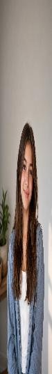

# שקף 5

**תבנית:** HookClosingText

## הנחיות הפקה (מתוך הערות השקף)

- שם המסך בפיגמה: HookClosingText

## תוכן השקף

- כדי שהתמונה לא תתעוות, צריך לשמור על יחס קבוע בין הרוחב לגובה שלה, המתאים לממדי המסך.
- המשך
- חזרה
- איזו תמונה גרועה שלי 

## תמונות רפרנס

