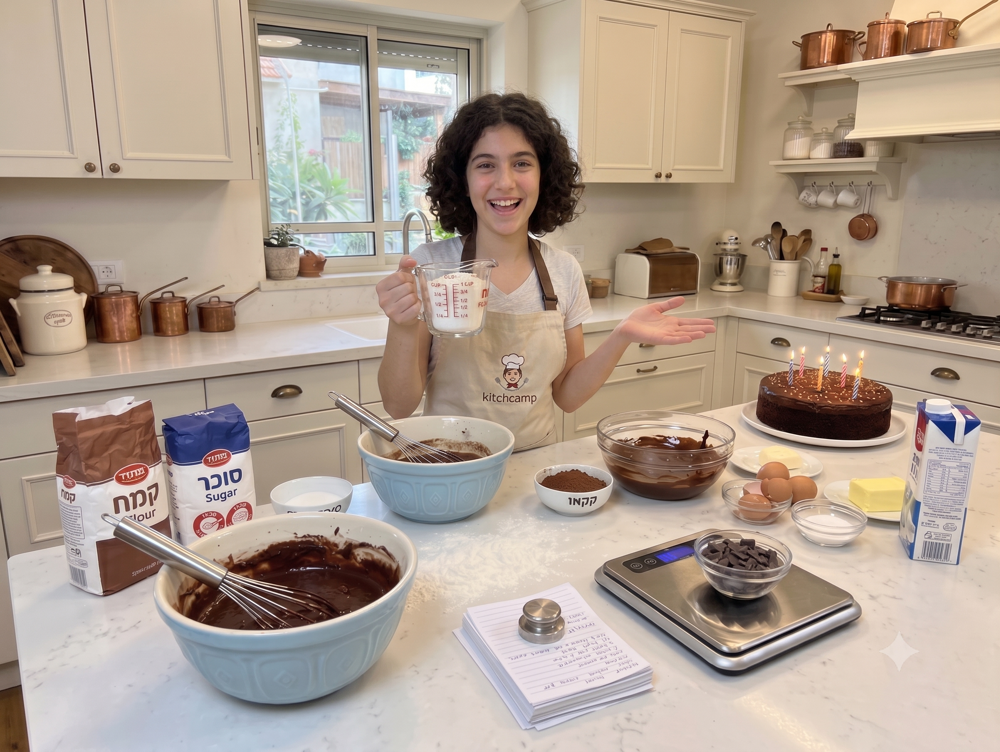

# שקף 8

**תבנית:** Carousel

## הנחיות הפקה (מתוך הערות השקף)

- שם המסך בפיגמה: Carousel
- משקל https://stock.adobe.com/images/kitchen-scales-on-a-white-background/86911039?prev_url=detail
- כוס סוכר https://stock.adobe.com/images/demerera-sugar-presented-in-an-american-metal-cup-measure/49011047?prev_url=detail (הבהרתי את התמונה כי היה רק סוכר חום ורציתי שזאת תהיה אותה הכוס).
- כוס קמח https://stock.adobe.com/images/plain-all-purpose-flour-presented-in-a-cup-measure/49011363

## תוכן השקף

- ניקח דוגמה מהמטבח של אביבית:
- במתכוני אפייה, כמויות המרכיבים יכולות להופיע בגרמים (יחידת משקל) או בכוסות מדידה (המודדות את נפח המרכיבים).
- כיצד נוכל לעבוד עם כוסות מדידה, כאשר מתכון רשום בגרמים?
- המשך
- חזרה
- איך מוודאים שפרופורציה נשמרת?
- כמה גרמים יש בכוס אחת?

## תמונות רפרנס

## הערות תיקוף (PPTX comments)

- **Guest User** (resolved): אושר:
הייתי משנה את המשפט ל:
לעיתים יש צורך בשמירה על יחס קבוע כאשר ממירים בין כמויות או בין יחידות מדידה שונות.

(היחס הקבוע הוא בעצם החיבור לפרופורציה)
-   ↳ **Guest User**: ניצה: מסכימה עם אושר
-   ↳ **Efrat Fridman**: תוקן
- **Guest User** (resolved): אושר: גם המשפט הזה מאוד מוזר לי , למה לא להיצמד לפתיחה שכתבנו?
-   ↳ **Guest User**: ניצה: מסכימה.
-   ↳ **Efrat Fridman**: העתקתי לפה את הגרסה המקורית של התוכן.
- **Guest User** (resolved): ניצה: חשוב לשמור על פרופורציה כשרוצים לשמור על פרופורציה. השאלה היא לא זו. השאלה היא "באילו מקרים בודקים אם הפרופורציה נשמרת או איך מוודאים שהפרופורציה נשמרת" ועוד דבר, שלא בא לביטוי: 
פרופורציה זה שוויון יחסים. 
חשוב לשמור על פרופורציה כשרוצים להשוות בין שני מצבים. 
במטרה לשמור על פרופורציה בהינתן יחס מסוים ועוד אחד הערכים של יחס אחר, אפשר למצוא את הנתון החסר כשרוצים לשמור על פרופורציה. 
היעד הזה מטרתו היא לדעת למצוא את הנתון הרביעי. כל זה בהנחה שביעד הקודם למדו מהי פרופורציה. הפתיחה בהחלט כיוונה למציאת הנתון הרביעי החסר וזה יפה. 
כאן זה לוקח ליחס המרה. זה מבלבל. בכלל אין צורך במושג הזה פה. יחס המרה באמת שמור ליחס של המרת מידות בתוך תחום: גרמים לק"ג, מטר לס"מ. אין פה באמת המרה. מבקשת להוריד את המושג מהחלק הזה.
-   ↳ **Efrat Fridman**: אושר - תראי בבקשה שהתייחסנו לכל ההערה הזו של ניצה. זה לא עובר אליה שוב.
-   ↳ **Guest User**: התייחסתי להערה הזו והכנסתי אותה בשקפים 6 ו-7, בעיני קצת מסורבל אבל אני מעדיפה ללכת עם מה שניצה כתבה.
