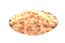
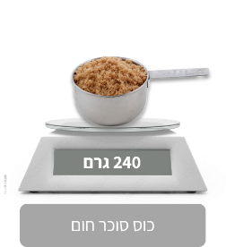
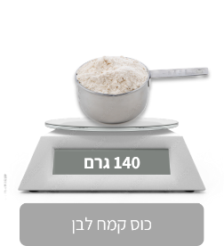
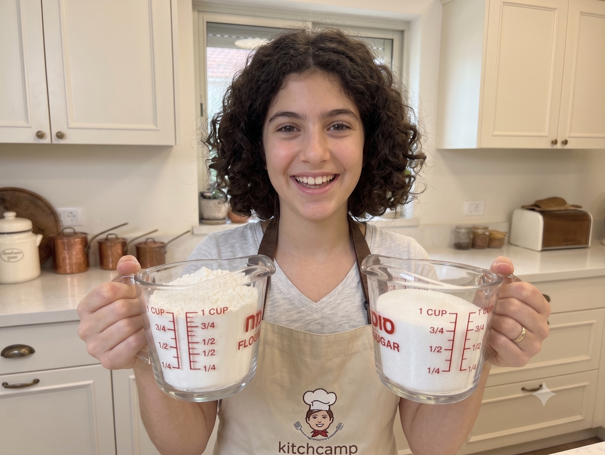

# שקף 9

**תבנית:** Carousel

## הנחיות הפקה (מתוך הערות השקף)

- שם המסך בפיגמה: Carousel
- משקל https://stock.adobe.com/images/kitchen-scales-on-a-white-background/86911039?prev_url=detail
- כוס סוכר https://stock.adobe.com/images/demerera-sugar-presented-in-an-american-metal-cup-measure/49011047?prev_url=detail (הבהרתי את התמונה כי היה רק סוכר חום ורציתי שזאת תהיה אותה הכוס).
- כוס קמח https://stock.adobe.com/images/plain-all-purpose-flour-presented-in-a-cup-measure/49011363

## תוכן השקף

- כמות הגרמים שמכילה כוס מדידה שונה בין מרכיבים שונים.
- לדוגמה, כוס קמח שוקלת פחות מכוס סוכר.
- ניתן להיעזר בפרופורציה (שוויון בין יחסים) בכדי להעביר כמויות מגרמים לכוסות מדידה באופן מדויק.
- המשך
- חזרה
- 200 גרם
- כוס סוכר לבן
- איך מוודאים שפרופורציה נשמרת?
- דיוק הוא המפתח לעוגה מוצלחת!​

## תמונות רפרנס

## הערות תיקוף (PPTX comments)

- **Guest User** (resolved): דקלה- משפט לא מנוסח טוב
-   ↳ **Guest User**: אושר: מסכימה,
אפשר להיצמד לניסוח המקורי.
שני השקפים הראשונים יכולים אולי להישאר כמו שכתבנו בלי קישור לסיפור ואז להכניס את אביבית.
-   ↳ **Guest User**: ניצה - מסכימה עם קודמותי
-   ↳ **Efrat Fridman**: הועתק הנוסח מהקובץ של אושר
