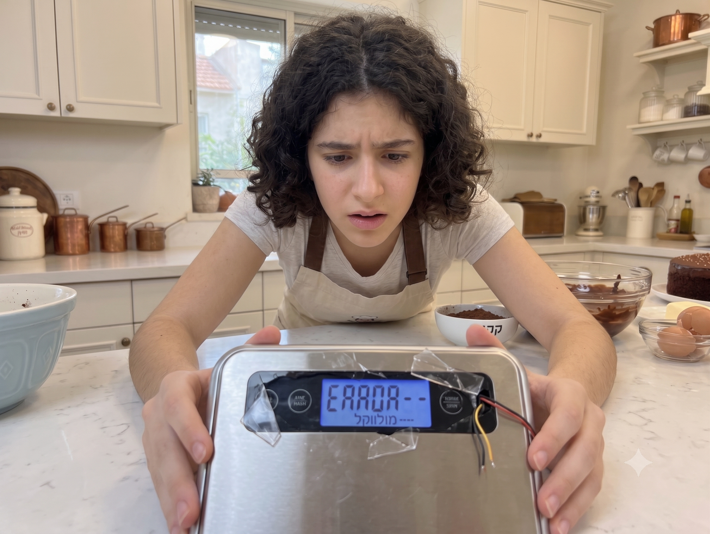

# שקף 10

**תבנית:** Carousel

## הנחיות הפקה (מתוך הערות השקף)

- שם המסך בפיגמה: Carousel
- את הטקסט במסגרת האדומה אפשר לעצב בתוך מסך מחשב

## תוכן השקף

- אביבית רוצה לאפות את עוגה לכבוד יום ההולדת של אמא שלה.
- כמויות המרכיבים במתכון מצוינות בגרמים, אבל המשקל הדיגיטלי שלה התקלקל ויש לה רק כוסות מדידה.
- במתכון כתוב שצריך 280 גרם קמח.
- אביבית חיפשה באינטרנט ומצאה:
- המשך
- חזרה
- אביבית אופה עוגה
- 1 כוס קמח לבן = 140  גרם

## תמונות רפרנס

## הערות תיקוף (PPTX comments)

- **Guest User** (resolved): דקלה- משפט כפול
