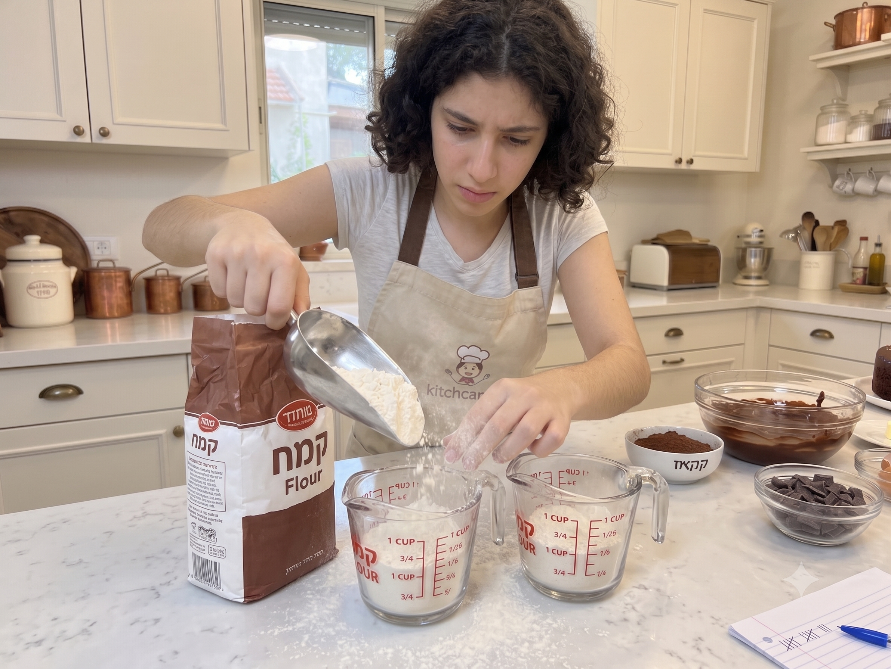

# שקף 11

**תבנית:** Carousel

## הנחיות הפקה (מתוך הערות השקף)

- שם המסך בפיגמה: Carousel וגם drag and drop

## תוכן השקף

- היחס עבור קמח הוא: 1 כוס קמח לבן = 140  גרם
- לפי המתכון, צריך 280 גרם קמח.
- נסמן: x - כמות כוסות הקמח הדרושות לאביבית.
- השלימו את טבלת הפרופורציה על ידי גרירה:
- חזרה
- המתכון של אביבית
- יחס ידוע
- 1
- מספר כוסות
- כמות בגרמים
- איך נמיר גרמים לכוסות מדידה?
- 140
- 280
- 280
- 140
- צדקתי?
- X
- X
- נכון!
- זוהי טבלת הפרופורציה הנכונה ממנה נוכל ליצור את המשוואה ולמצוא את הנעלם.
- לא מדויק, הנה התשובה וההסבר:
- המתכון של אביבית
- יחס ידוע
- X
- 1
- מספר כוסות
- 280
- 140
- כמות בגרמים
- המתכון של אביבית
- יחס ידוע
- X
- 1
- מספר כוסות
- 280
- 140
- כמות בגרמים

## תמונות רפרנס

## הערות תיקוף (PPTX comments)

- **Guest User** (resolved): דקלה- עד כאן הילד לא היה פעיל
-   ↳ **Guest User**: ניצה: מסכימה מאד. יש מספר מקומות שאפשר לשאול תלמיד שאלות. וגם שאלות כמו אם נהפוך את המונה והמכנה, הרי זה גם נכון בתנאי ששומרים על ההתאמה.
-   ↳ **Efrat Fridman**: הוכנסה שאלה
- **Efrat Fridman** (resolved): הוספתי גם את האיקס לגרירה. נראה לי שיוכלו להתמודד.
- **Efrat Fridman** (resolved): אושר - תוכלי בבקשה להשלים את ההסבר למי שטועה בשאלה?
-   ↳ **Guest User**: אושר: לדעתי אין צורך בהסבר כי זה ממש בסיסי, רק לסדר את הנתונים בטבלה.
צריך להעתיק את הטבלה עם הכותרות המתוקנות למשוב ( לא הצלחתי)
