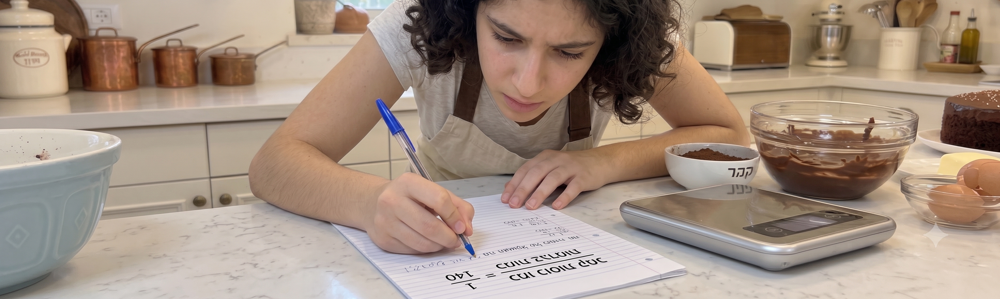

# שקף 12

**תבנית:** Carousel

## הנחיות הפקה (מתוך הערות השקף)

- שם המסך בפיגמה: Carousel

## תוכן השקף

- כדי לשמור על דיוק , ניעזר בפרופורציה –
- שוויון יחסים בין מספר כוסות המדידה לכמות בגרמים.
- בכתיבת פרופורציה, יש חשיבות גדולה לסדר המילים והמספרים.
- המשך
- חזרה
- איך נמיר גרמים לכוסות מדידה?

## תמונות רפרנס

## הערות תיקוף (PPTX comments)

- **Guest User** (resolved): ניצה: הייתי מכניסה כאן את האלמנט של משוואה. כותבת את ה-280 גרם הידוע. ושמה משהו אחר במונה. כן מציגה את המילים "כוסות קמח" (כוסות זה מספר ולא כמות) מול "גרמים" במין בועות מרחבות המכוונות למונה ולמכנה
-   ↳ **Guest User**: לא כל כך הבנתי אבל אני חושבת שנוותר על השלב הזה.
