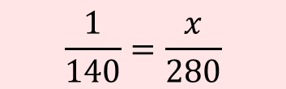

# שקף 13

**תבנית:** Carousel

## הנחיות הפקה (מתוך הערות השקף)

- שם המסך בפיגמה: Carousel
- וגם
- singlechoice

## תוכן השקף

- בהנתן טבלת הפרופורציה המלאה:
- קבעו - מה משוואת הפרופורציה המתאימה? בחרו בכל התשובות המתאימות.
- חזרה
- המתכון של אביבית
- יחס ידוע
- x
- 1
- מספר כוסות
- 280
- 140
- כמות גרמים
- איך נמיר גרמים לכוסות מדידה?
- צדקתי?
- תשובה נכונה, כל הכבוד!
- אם נכתוב את היחס בין כוסות (1) לגרמים (140), אז היחס המתאים בפרופורציה ייכתב כך שמספר הכוסות במונה וכמות הגרמים במכנה.
- אפשר גם לכתוב את היחס בין גרמים (140) לכוסות (1), ואז היחס המתאים בפרופורציה ייכתב באותו סדר - גרמים במונה וכוסות במכנה.
- ולכן יש שתי תשובות נכונות.
- מספר  כוסות הקמח שאביבית
- רוצה לחשב
- כמות הגרמים של קמח במתכון
- היחס הידוע  בין כוסות לגרמים עבור קמח לבן
- היחס הידוע  בין גרמים לכוסות עבור קמח לבן
- כמות הגרמים של קמח במתכון
- מספר  כוסות הקמח שאביבית
- רוצה לחשב
- זו טעות. לא נורא, ככה נבנית הבנה.
- בואו נסביר:
- אם נכתוב את היחס בין כוסות (1) לגרמים (140), אז היחס המתאים בפרופורציה ייכתב כך שמספר הכוסות במונה וכמות הגרמים במכנה.
- אפשר גם לכתוב את היחס בין גרמים (140) לכוסות (1), ואז היחס המתאים בפרופורציה ייכתב באותו סדר - גרמים במונה וכוסות במכנה.
- ולכן יש שתי תשובות נכונות.
- מספר  כוסות הקמח שאביבית
- רוצה לחשב
- כמות הגרמים של קמח במתכון
- היחס הידוע  בין כוסות לגרמים עבור קמח לבן
- היחס הידוע  בין גרמים לכוסות עבור קמח לבן
- כמות הגרמים של קמח במתכון
- מספר  כוסות הקמח שאביבית
- רוצה לחשב

## תמונות רפרנס

## הערות תיקוף (PPTX comments)

- **Guest User** (resolved): אושר: לדעתי אין צורך במשפטים האלה, כי בשקף הקודם כתבנו אותם.
להציג את הטבלה פשוט ולכתוב שזוהי טבלת הפרופורציה עבור כמות הקמח.
-   ↳ **Guest User**: מסכימה.
פחות מלל
-   ↳ **Guest User**: ניצה: בכוונה הורדתם את האפשרות של 280 חלקי x שווה ל 140 חלקי 1 אבל זו פרופורציה נכונה וצריך לחשוף אותה ולכתוב על זה. אין רק דרך אחת.
-   ↳ **Efrat Fridman**: אושר - תוכלי בבקשה להשלים את ההסבר שניצה ביקשה?
-   ↳ **Guest User**: אושר: אני לא מצליחה להוסיף את האפשרות שניצה ביקשה
-   ↳ **Guest User**: 280/x 
= 
140/1
-   ↳ **Guest User**: להוסיף את זה גם במשוב איפה שחסר ולהעתיק את המשוב למשוב שלילי גם
