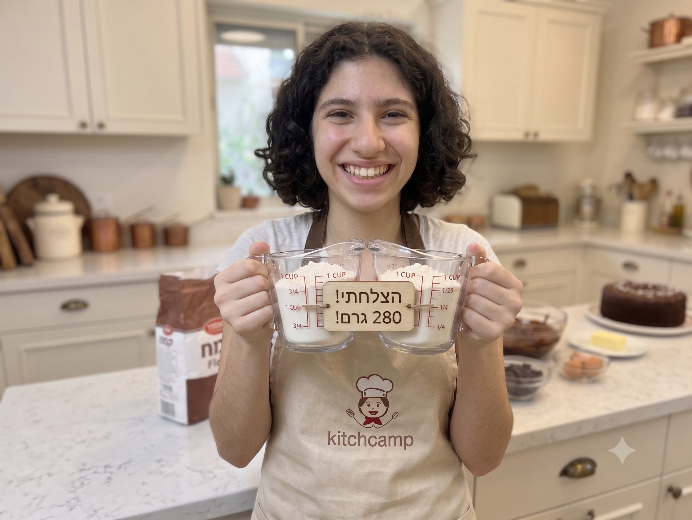

# שקף 15

**תבנית:** Carousel

## הנחיות הפקה (מתוך הערות השקף)

- שם המסך בפיגמה: Carousel

## תוכן השקף

- המשך
- חזרה
- כמה כוסות קמח לבן צריך במתכון?
- אם הגרמים גדלו פי 2 – גם הכוסות גדלות פי 2!
- נשים לב ש:
- כדי שיתקיים שוויון, השבר  צריך להיות הרחבה פי 2 של השבר
- ולכן:
- כלומר, אביבית צריכה 2 כוסות קמח.

## תמונות רפרנס

## הערות תיקוף (PPTX comments)

- **Guest User** (resolved): אושר: אני לא רואה פה את ההסבר רק את המכפלה ביחס
-   ↳ **Efrat Fridman**: להוסיף גם מלל ש - 140 * 2 = 280
-   ↳ **Efrat Fridman**: להסתכל איך רשום בתסריט הקודם
-   ↳ **Efrat Fridman**: תוקן
