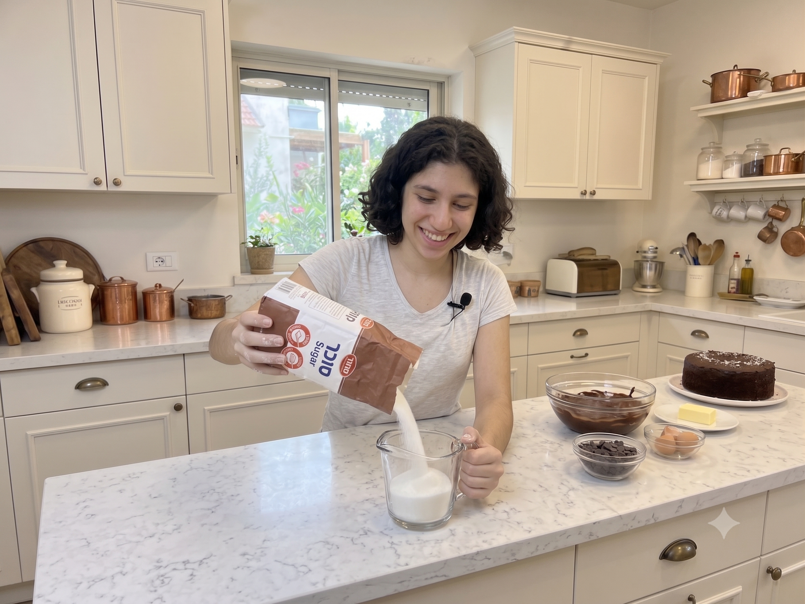
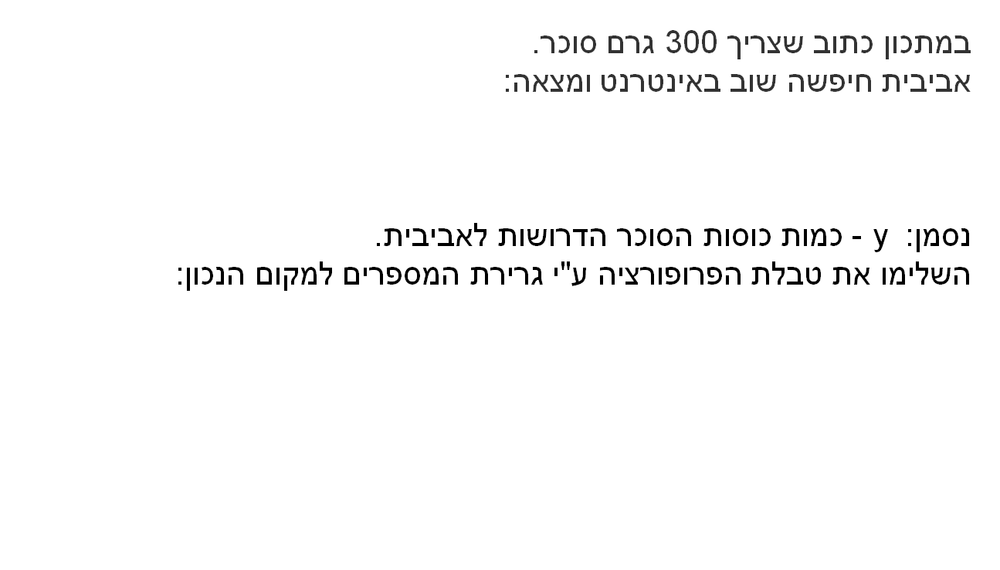

# שקף 16

**תבנית:** Carousel

## הנחיות הפקה (מתוך הערות השקף)

- שם המסך בפיגמה: Carousel
- וגם draganddrop
- את הטקסט במסגרת האדומה אפשר לעצב בתוך מסך מחשב

## תוכן השקף

- במתכון כתוב שצריך 300 גרם סוכר.
- אביבית חיפשה שוב באינטרנט ומצאה:
- נסמן: y  - כמות כוסות הסוכר הדרושות לאביבית.
- השלימו את טבלת הפרופורציה ע"י גרירת המספרים למקום הנכון:
- 1 כוס סוכר = 200  גרם
- חזרה
- המתכון של אביבית
- יחס ידוע
- y
- מספר כוסות סוכר
- כמות סוכר בגרמים
- כמה כוסות סוכר אביבית צריכה?
- 200
- 300
- 300
- 200
- צדקתי?
- 1
- 1
- התשובה נכונה. זה מראה על הבנה!
- זוהי טבלת הפרופורציה הנכונה ממנה נוכל ליצור את המשוואה ולמצוא את הנעלם.
- לא מדויק, הנה הטבלה הנכונה:
- המתכון של אביבית
- יחס ידוע
- Y
- 1
- מספר כוסות סוכר
- 300
- 200
- כמות בגרמים
- המתכון של אביבית
- יחס ידוע
- Y
- 1
- מספר כוסות סוכר
- 300
- 200
- כמות בגרמים

## תמונות רפרנס

