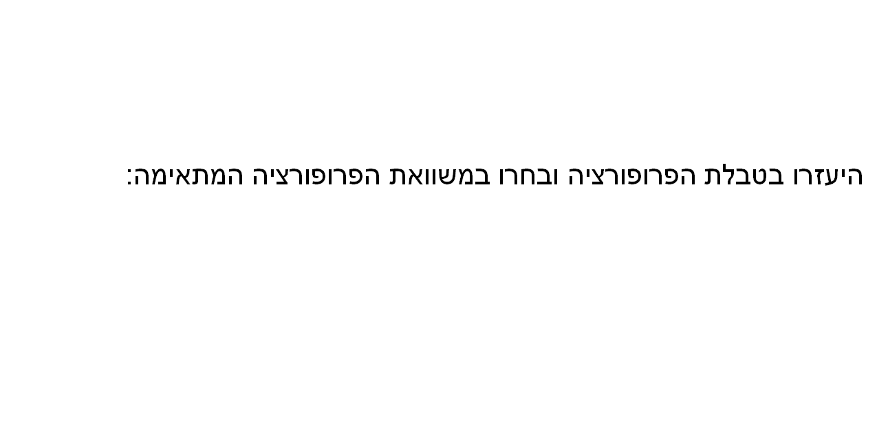

# שקף 17

**תבנית:** Carousel

## הנחיות הפקה (מתוך הערות השקף)

- שם המסך בפיגמה: Carousel
- וגם singlechoice
- הבועית יוצאת מהדמות  בתמונה.
- את הטקסט במסגרת האדומה אפשר לעצב בתוך מסך מחשב

## תוכן השקף

- היעזרו בטבלת הפרופורציה ובחרו במשוואת הפרופורציה המתאימה:
- חזרה
- המתכון של אביבית
- יחס ההמרה
- y
- 1
- מספר כוסות סוכר
- 300
- 200
- כמות סוכר בגרמים
- צדקתי?
- כמה כוסות סוכר אביבית צריכה?

## תמונות רפרנס

