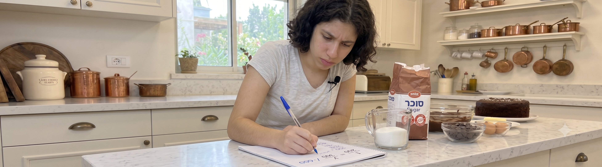

# שקף 19

**תבנית:** Carousel

## הנחיות הפקה (מתוך הערות השקף)

- שם המסך בפיגמה: Carousel

## תוכן השקף

- כדי למצוא את y (כמות כוסות הסוכר),
- הפעם נפתור את המשוואה על ידי הכפלה במכנה המשותף:
- כלומר, אביבית צריכה להכנת העוגה 1.5 כוסות סוכר.
- המשך
- חזרה
- המכנה המשותף
- כמה כוסות סוכר אביבית צריכה?
- זו משוואה שקל לי לפתור!

## תמונות רפרנס

## הערות תיקוף (PPTX comments)

- **Guest User** (resolved): לא רואים את ההסברים רק את המשוואה
