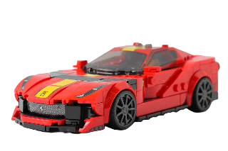

# שקף 23

**תבנית:** Guided

## הנחיות הפקה (מתוך הערות השקף)

- שם המסך בפיגמה:
- Guided Math Practice Screen
- תמונה https://stock.adobe.com/images/lego-car-ferrari-812-competizione/2051287723?prev_url=detail

## תוכן השקף

- בואו נפתור תרגיל ראשון יחד
- התבוננו בתרגיל הבא. אל תפתרו אותו, רק קראו את הנתונים וחישבו האם יש לכם כיוון לפתרון.
- חברת צעצועי הרכבה החליטה לבנות דגם ענק של מכונית יוקרה.
- כדי שהדגם המוגדל ייראה כמו הדגם המקורי,  עליה לשמור על פרופורציה בין הממדים של שני הדגמים.
- גובה הדגם המקורי הוא 4 ס"מ, אורכו 16 ס"מ.
- החברה מעוניינת שאורך הדגם המוגדל לתצוגה יהיה 80 ס"מ.
- מה צריך להיות גובה הדגם המוגדל כדי תישמר הפרופורציה?
- מיד נסביר את הפתרון, שלב אחר שלב
- 4 ס"מ
- 16 ס"מ

## תמונות רפרנס

## הערות תיקוף (PPTX comments)

- **Guest User** (resolved): דקלה- המשפט הזה לא טוב וגם אפרת אמרה שהילד כן שותף בפתרון
-   ↳ **Efrat Fridman**: המשפט מופיע רק במסך הראשון כדי שהם יקראו את השאלה.
