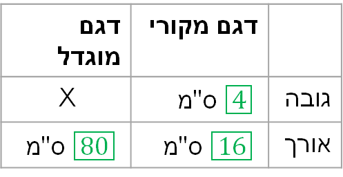

# שקף 24

**תבנית:** Guided

## הנחיות הפקה (מתוך הערות השקף)

- שם המסך בפיגמה:
- Guided Math Practice Screen

## תוכן השקף

- בואו נפתור תרגיל ראשון יחד
- לפני שנתחיל לחשב,
- נעזר בטבלת הפרופורציה לארגון הנתונים.
- חברת צעצועי הרכבה החליטה לבנות דגם ענק של מכונית יוקרה.
- כדי שהדגם המוגדל ייראה כמו הדגם המקורי,  עליה לשמור על פרופורציה בין הממדים של שני הדגמים.
- גובה הדגם המקורי הוא 4 ס"מ, אורכו 16 ס"מ.
- החברה מעוניינת שאורך הדגם המוגדל לתצוגה יהיה 80 ס"מ.
- מה צריך להיות גובה הדגם המוגדל כדי שתישמר הפרופורציה?
- דגם מוגדל
- דגם מקורי
- X
- ס"מ
- גובה
- ס"מ
- ס"מ
- אורך
- דגם מוגדל
- דגם מקורי
- X
- גובה
- אורך

## תמונות רפרנס

## הערות תיקוף (PPTX comments)

- **Guest User** (resolved): אושר: בבקשה להיצמד בדיוק למה שכתבתי בגרסה האחרונה שאיריס שלחה. בטבלה שם מופיע x כבר, לתקן הכל לפי זה. 
יש חשיבות לדברים האלה
-   ↳ **Efrat Fridman**: תוקן
