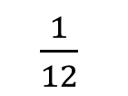
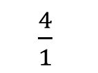
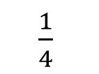

# שקף 25

**תבנית:** Guided

## הנחיות הפקה (מתוך הערות השקף)

- שם המסך בפיגמה:
- Guided Math Practice Screen

## תוכן השקף

- חברת צעצועי הרכבה החליטה לבנות דגם ענק של מכונית יוקרה.
- כדי שהדגם המוגדל ייראה כמו הדגם המקורי,  עליה לשמור על פרופורציה בין הממדים של שני הדגמים.
- גובה הדגם המקורי הוא 4 ס"מ, אורכו 16 ס"מ.
- החברה מעוניינת שאורך הדגם המוגדל לתצוגה יהיה 80 ס"מ.
- מה צריך להיות גובה הדגם המוגדל כדי תישמר הפרופורציה?
- בואו נפתור תרגיל ראשון יחד
- התבוננו בתרגיל הבא. אל תפתרו אותו, רק הסתכלו על הנתונים וחישבו האם יש לכם כיוון לפתרון.
- כדי שצורת הדגם לא תתעוות, יש לשמור על פרופורציה (שוויון יחסים) בין גובה הדגם לאורכו.
- מה היחס המצומצם בין הגובה לאורך של הדגם המקורי?
- דגם מוגדל
- דגם מקורי
- ?
- 4 ס"מ
- גובה
- 80 ס"מ
- 16 ס"מ
- אורך
- נכון

## תמונות רפרנס

