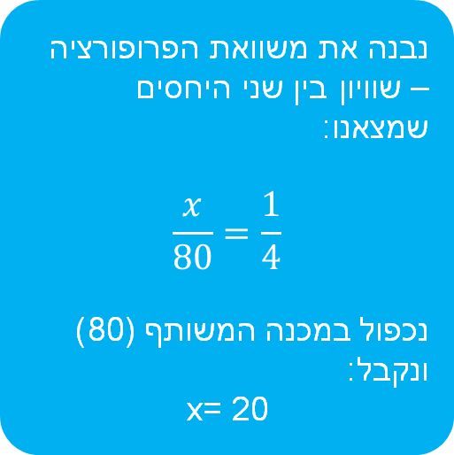

# שקף 28

**תבנית:** Guided

## הנחיות הפקה (מתוך הערות השקף)

- שם המסך בפיגמה:
- Guided Math Practice Screen

## תוכן השקף

- בואו נפתור תרגיל ראשון יחד
- התבוננו בתרגיל הבא. אל תפתרו אותו, רק הסתכלו על הנתונים וחישבו האם יש לכם כיוון לפתרון.
- נבנה את משוואת הפרופורציה – שוויון בין שני היחסים שמצאנו:
- נכפול במכנה המשותף (80) ונקבל:
- x= 20
- חברת צעצועי הרכבה החליטה לבנות דגם ענק של מכונית יוקרה.
- כדי שהדגם המוגדל ייראה כמו הדגם המקורי,  עליה לשמור על פרופורציה בין הממדים של שני הדגמים.
- גובה הדגם המקורי הוא 4 ס"מ, אורכו 16 ס"מ.
- החברה מעוניינת שאורך הדגם המוגדל לתצוגה יהיה 80 ס"מ.
- מה צריך להיות גובה הדגם המוגדל כדי תישמר הפרופורציה?
- דגם מוגדל
- דגם מקורי
- x
- 4 ס"מ
- גובה
- 80 ס"מ
- 16 ס"מ
- אורך

## תמונות רפרנס

