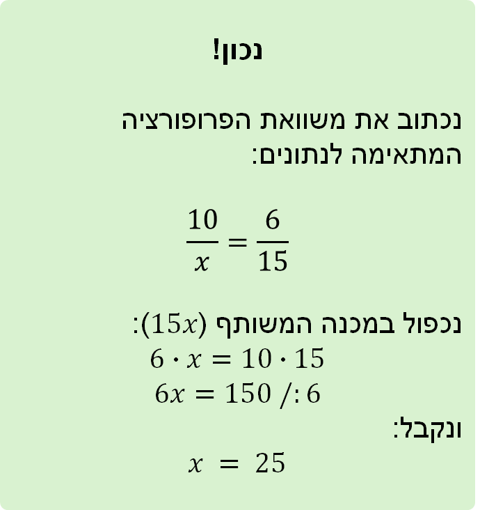
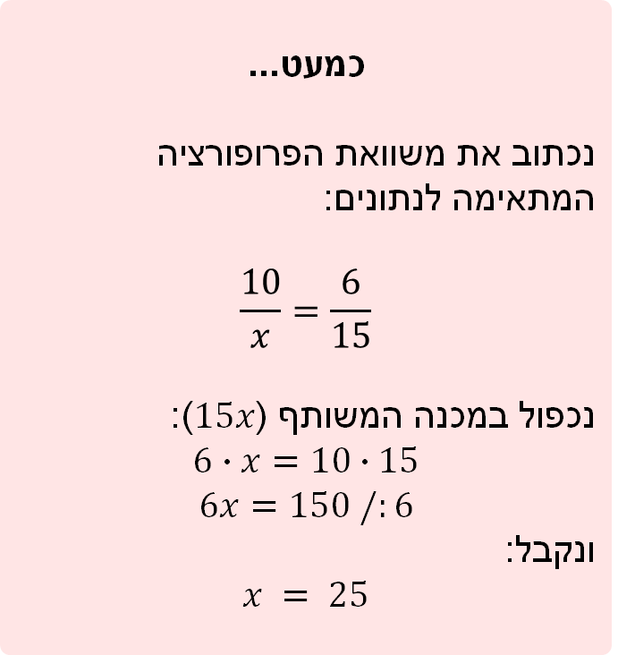

# שקף 31

**תבנית:** ValueInputQuestion

## הנחיות הפקה (מתוך הערות השקף)

- שם המסך בפיגמה:ValueInputQuestion
- מקטע זה מלווה בסרגל שאלה, שאלה 1 מתוך 2

## תוכן השקף

- צדקתי?
- שאלה 1
- היחס בין 10 ל-x שווה ליחס בין 6 ל-15.
- מצאו את x.
- 25
- אפשר רמז?
- חזרה
- שימו לב!
- מהי משוואת הפרופורציה (שוויון היחסים) המתאימה לנתונים?
- חזרה לשאלה
- נכון!
- נכתוב את משוואת הפרופורציה המתאימה לנתונים:
- נכפול במכנה המשותף ():
- ונקבל:
- כמעט...
- נכתוב את משוואת הפרופורציה המתאימה לנתונים:
- נכפול במכנה המשותף ():
- ונקבל:
- רמת חשיבה

## תמונות רפרנס

