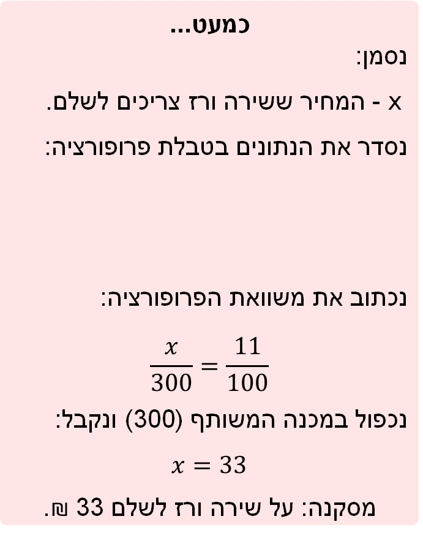
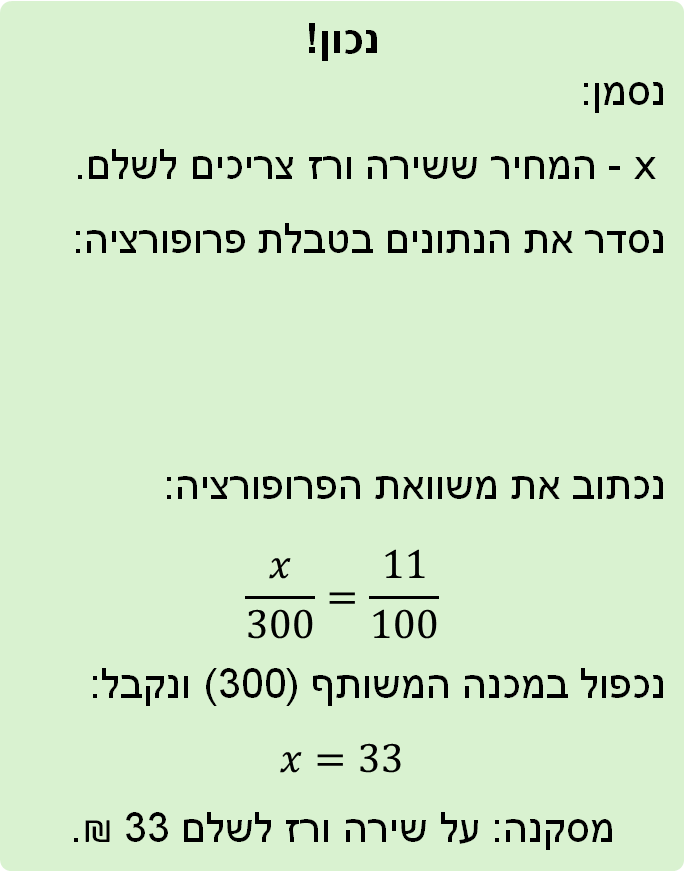

# שקף 32

**תבנית:** ValueInputQuestion

## הנחיות הפקה (מתוך הערות השקף)

- שם המסך בפיגמה:ValueInputQuestion
- מקטע זה מלווה בסרגל שאלה, שאלה 2 מתוך 2

## תוכן השקף

- צדקתי?
- שאלה 2
- במזנון הקולנוע מוכרים פופקורן בתפזורת במחיר קבוע לפי משקל.
- על השלט כתוב "המחיר לפי משקל: 11 ₪ ל-100 גרם פופקורן".
- שירה ורז מילאו שקית פופקורן במשקל 300 גרם.
- כמה עליהם לשלם?                                                ש"ח
- אפשר רמז?
- חזרה
- רמת חשיבה
- חשבו:
- מה היחס בין משקלי הפופקורן?
- מה עליכם לעשות למחיר כדי לשמור על אותו היחס?
- חזרה לשאלה
- נכון!
- נסמן:
- x - המחיר ששירה ורז צריכים לשלם.
- נסדר את הנתונים בטבלת פרופורציה:
- נכתוב את משוואת הפרופורציה:
- נכפול במכנה המשותף (300) ונקבל:
- מסקנה: על שירה ורז לשלם 33 ₪.
- כמעט...
- נסמן:
- x - המחיר ששירה ורז צריכים לשלם.
- נסדר את הנתונים בטבלת פרופורציה:
- נכתוב את משוואת הפרופורציה:
- נכפול במכנה המשותף (300) ונקבל:
- מסקנה: על שירה ורז לשלם 33 ₪.
- 33
- משקל (גרם)
- מחיר (₪ )
- 100
- 11
- 300
- x
- משקל (גרם)
- מחיר (₪ )
- 100
- 11
- 300
- x

## תמונות רפרנס

