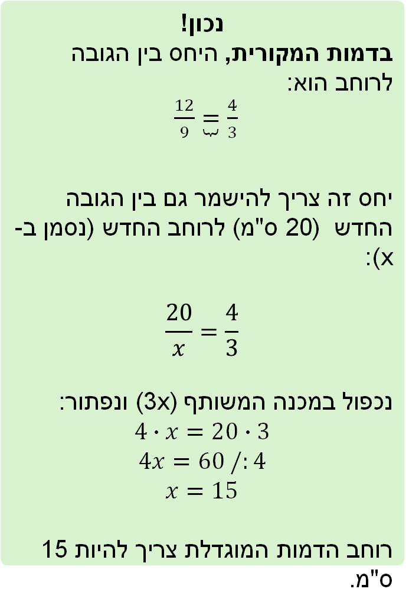
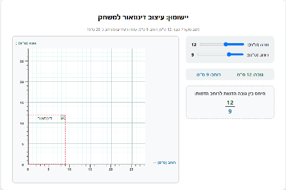
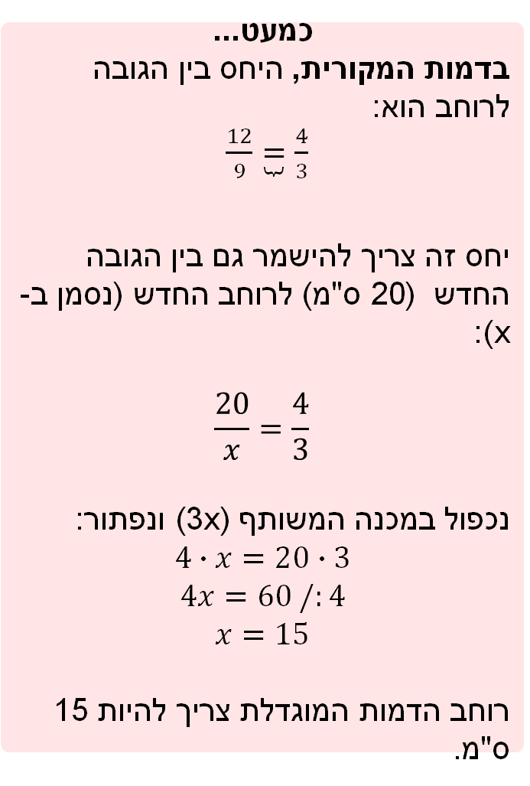

# שקף 35

**תבנית:** ValueInputQuestion

## הנחיות הפקה (מתוך הערות השקף)

- יישומון
- שם המסך בפיגמה:ValueInputQuestion
- מקטע זה מלווה בסרגל שאלה, שאלה 1 מתוך 5
- https://methodiccoil.sharepoint.com/Organization%20Data/Forms/AllItems.aspx?viewid=c026585c%2D8c56%2D4583%2D9790%2D8161b4c7c32b&ct=1783519175986&or=OWA%2DNT%2DMail&ga=1&id=%2FOrganization%20Data%2FFTP%2F%D7%9E%D7%A9%D7%A8%D7%93%20%D7%94%D7%97%D7%99%D7%A0%D7%95%D7%9A%2F720%2F%D7%AA%D7%A9%D7%A4%D7%96%2F%D7%9E%D7%AA%D7%9E%D7%98%D7%99%D7%A7%D7%94%2F02%5F%D7%A4%D7%A8%D7%95%D7%A4%D7%95%D7%A8%D7%A6%D7%99%D7%94%2F2%2E2%20%D7%9E%D7%A6%D7%99%D7%90%D7%AA%20%D7%94%D7%9E%D7%A1%D7%A4%D7%A8%20%D7%90%D7%99%D7%A7%D7%A1%20%D7%94%D7%97%D7%A1%D7%A8%20%28%D7%90%D7%91%D7%99%D7%98%D7%9C%29%2F%D7%AA%D7%95%D7%9B%D7%9F%20%D7%9E%D7%AA%D7%9E%D7%98%D7%99%2F%D7%A2%D7%99%D7%A6%D7%95%D7%91%20%D7%93%D7%9E%D7%95%D7%AA%20%D7%93%D7%99%D7%A0%D7%95%D7%96%D7%90%D7%95%D7%A8%2Ehtml&parent=%2FOrganization%20Data%2FFTP%2F%D7%9E%D7%A9%D7%A8%D7%93%20%D7%94%D7%97%D7%99%D7%A0%D7%95%D7%9A%2F720%2F%D7%AA%D7%A9%D7%A4%D7%96%2F%D7%9E%D7%AA%D7%9E%D7%98%D7%99%D7%A7%D7%94%2F02%5F%D7%A4%D7%A8%D7%95%D7%A4%D7%95%D7%A8%D7%A6%D7%99%D7%94%2F2%2E2%20%D7%9E%D7%A6%D7%99%D7%90%D7%AA%20%D7%94%D7%9E%D7%A1%D7%A4%D7%A8%20%D7%90%D7%99%D7%A7%D7%A1%20%D7%94%D7%97%D7%A1%D7%A8%20%28%D7%90%D7%91%D7%99%D7%98%D7%9C%29%2F%D7%AA%D7%95%D7%9B%D7%9F%20%D7%9E%D7%AA%D7%9E%D7%98%D7%99

## תוכן השקף

- צדקתי?
- תלמידים בנו סקיצה של דמות דינוזאור עבור משחק מחשב.
- בסקיצה הראשונית, ממדי הדינוזאור היו:
- גובה: 12 ס"מ
- רוחב: 9 ס"מ
- כדי שהדמות תתאים למסך מחשב, יש להגדיל את דמות הדינוזאור כך שגובהה החדש יהיה 20 ס"מ, תוך שמירה על פרופורציה (שוויון יחסים) בין הממדים.
- העזר בישמון כדי למצוא את התשובה.
- מה צריך להיות הרוחב החדש של דמות הדינוזאור(בסנטימטרים)?
- אפשר רמז?
- חזרה
- היעזרו ביישומון – שנו את ממדי דמות הדינוזאור בהתאם לדרישה כך שיישמר היחס המקורי בין הגובה לרוחב שלו.
- חזרה לשאלה
- נכון!
- בדמות המקורית, היחס בין הגובה לרוחב הוא:
- יחס זה צריך להישמר גם בין הגובה החדש  (20 ס"מ) לרוחב החדש (נסמן ב-x):
- נכפול במכנה המשותף (3x) ונפתור:
- רוחב הדמות המוגדלת צריך להיות 15 ס"מ.
- כמעט...
- בדמות המקורית, היחס בין הגובה לרוחב הוא:
- יחס זה צריך להישמר גם בין הגובה החדש  (20 ס"מ) לרוחב החדש (נסמן ב-x):
- נכפול במכנה המשותף  (3x)ונפתור:
- רוחב הדמות המוגדלת צריך להיות 15 ס"מ.
- 15 ס"מ
- רמת חשיבה
- צמצום ב-3
- צמצום ב-3
- הפקה- שילוב ישומון

## תמונות רפרנס

