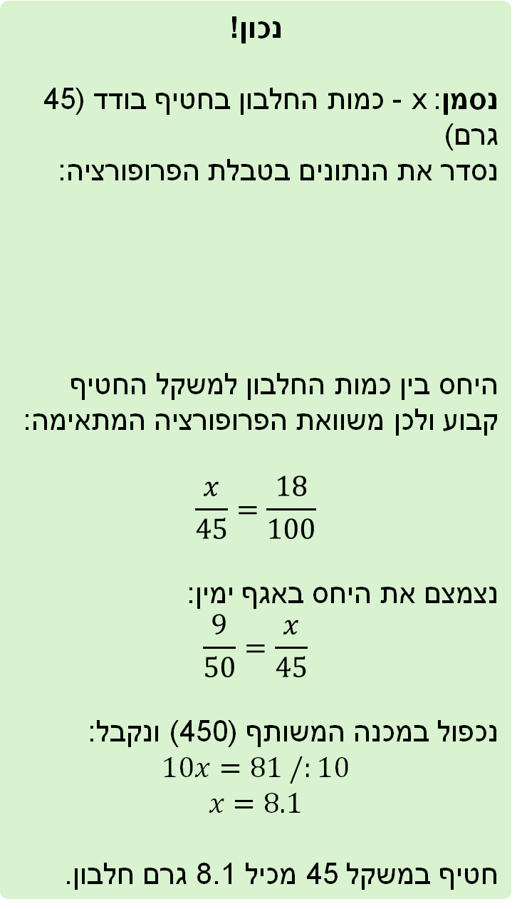
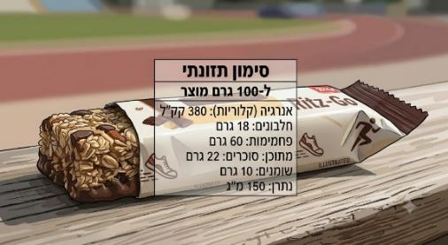
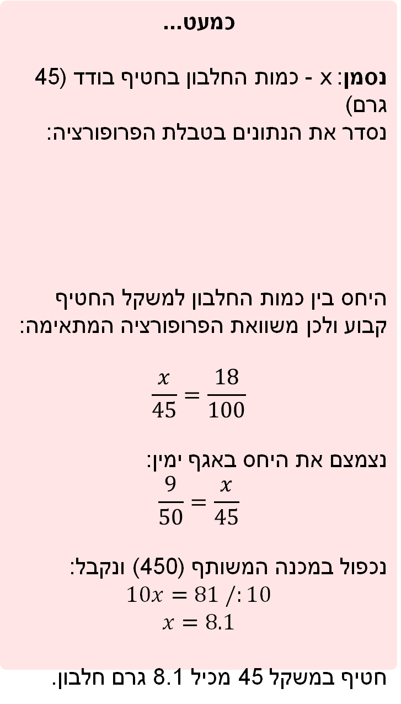

# שקף 36

**תבנית:** ValueInputQuestion

## הנחיות הפקה (מתוך הערות השקף)

- שם המסך בפיגמה:ValueInputQuestion
- מקטע זה מלווה בסרגל שאלה, שאלה 2 מתוך 5

## תוכן השקף

- צדקתי?
- ניב רכש בקפיטריה של בית הספר חטיף בריאות חדש.
- על החטיף מצוינים הערכים התזונתיים ל-100 גרם – כל 100 גרם חטיף מכיל 18 חלבונים.
- משקל חטיף אנרגיה בודד הוא 45 גרם.
- כמה גרם חלבון מכיל חטיף בריאות בודד?
- אפשר רמז?
- חזרה
- שימו לב!
- מה היחס בין כמות החלבון למשקל המוצר עבור 100 גרם?
- יחס זה צריך להישמר גם עבור 45 גרם.
- חזרה לשאלה
- נכון!
- נסמן:x  - כמות החלבון בחטיף בודד (45 גרם)
- נסדר את הנתונים בטבלת הפרופורציה:
- היחס בין כמות החלבון למשקל החטיף קבוע ולכן משוואת הפרופורציה המתאימה:
- נצמצם את היחס באגף ימין:
- נכפול במכנה המשותף (450) ונקבל:
- חטיף במשקל 45 מכיל 8.1 גרם חלבון.
- כמעט...
- נסמן:x  - כמות החלבון בחטיף בודד (45 גרם)
- נסדר את הנתונים בטבלת הפרופורציה:
- היחס בין כמות החלבון למשקל החטיף קבוע ולכן משוואת הפרופורציה המתאימה:
- נצמצם את היחס באגף ימין:
- נכפול במכנה המשותף (450) ונקבל:
- חטיף במשקל 45 מכיל 8.1 גרם חלבון.
- רמת חשיבה
- 8.1
- חטיף בודד
- סימון תזונתי
- x
- 18
- כמות חלבון (גרם)
- 45
- 100
- משקל (גרם)
- חטיף בודד
- סימון תזונתי
- x
- 18
- כמות חלבון (גרם)
- 45
- 100
- משקל (גרם)
- גרם חלבון

## תמונות רפרנס

