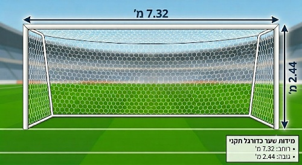
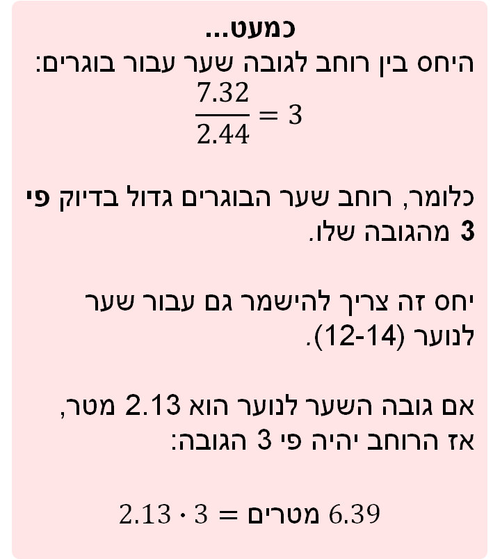
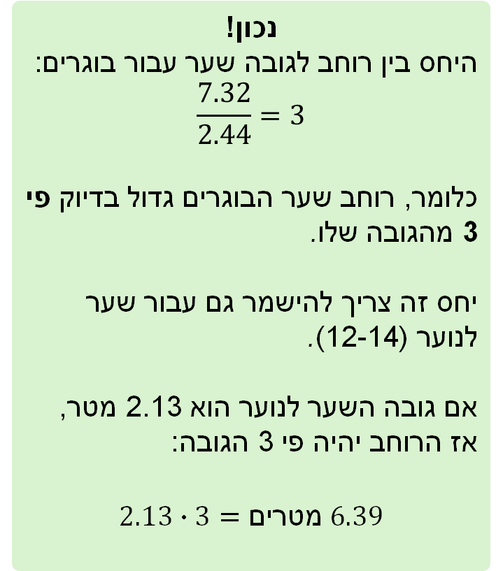

# שקף 37

**תבנית:** ValueInputQuestion

## הנחיות הפקה (מתוך הערות השקף)

- שם המסך בפיגמה:ValueInputQuestion
- מקטע זה מלווה בסרגל שאלה, שאלה 3 מתוך 5

## תוכן השקף

- צדקתי?
- מידות שער כדורגל תקני משתנות בהתאם לגיל השחקנים.
- בליגת בוגרים (גילאי 15 ומעלה), מידות שער תקני הן
- רוחב: 7.32 מטר.
- גובה: 2.44 מטר.
- לשכבות גיל צעירות יותר, השערים מוקטנים כדי להתאים לממדי הגוף ולשטח המגרש.
- לנערים בגילאי 12-14, - גובה השער הוא 2.13 מטר.
- מהו רוחב השער המתאים, כך שישמר היחס בין רוחב לגובה של שער תקני לבוגרים?
- אפשר רמז?
- חזרה
- רמת חשיבה
- שימו לב:
- מה היחס בין רוחב השער של הבוגרים לגובה שלו?
- יחס זה צריך להיות זהה גם בשער לנערים.
- חזרה לשאלה
- נכון!
- היחס בין רוחב לגובה שער עבור בוגרים:
- כלומר, רוחב שער הבוגרים גדול בדיוק פי 3 מהגובה שלו.
- יחס זה צריך להישמר גם עבור שער לנוער (12-14).
- אם גובה השער לנוער הוא 2.13 מטר, אז הרוחב יהיה פי 3 הגובה:
- כמעט...
- היחס בין רוחב לגובה שער עבור בוגרים:
- כלומר, רוחב שער הבוגרים גדול בדיוק פי 3 מהגובה שלו.
- יחס זה צריך להישמר גם עבור שער לנוער (12-14).
- אם גובה השער לנוער הוא 2.13 מטר, אז הרוחב יהיה פי 3 הגובה:
- 6.39
- מטרים

## תמונות רפרנס

