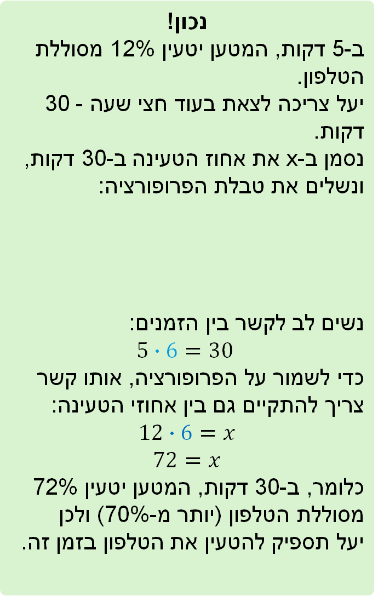
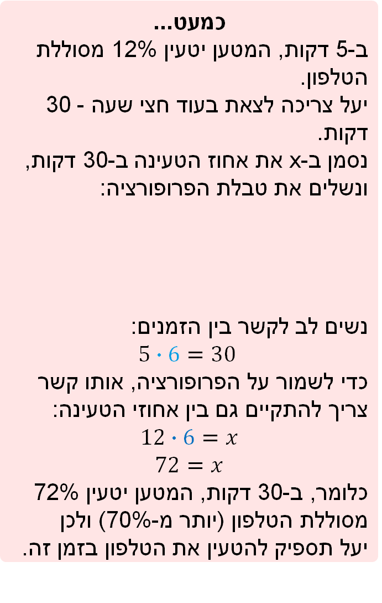

# שקף 38

**תבנית:** SingleChoiceQuestionImage

## הנחיות הפקה (מתוך הערות השקף)

- שם המסך בפיגמה:SingleChoiceQuestionImage
- מקטע זה מלווה בסרגל שאלה, שאלה 4 מתוך 5

## תוכן השקף

- צדקתי?
- מטען לטלפון נייד מסוגל להטעין כל 5 דקות 12% סוללה.
- יעל רוצה להטעין את הטלפון לרמת טעינה של 70%, אבל היא צריכה לצאת מהבית בעוד חצי שעה.
- האם יעל תספיק להטעין את הטלפון?
- לא ניתן לדעת
- לא
- כן
- אפשר רמז?
- חזרה
- חשבו:
- אם ב-5 דקות המטען מטעין 12%, כמה אחוזי סוללה יטעין בחצי שעה (30 דקות)?
- חזרה לשאלה
- נכון!
- ב-5 דקות, המטען יטעין 12% מסוללת הטלפון.
- יעל צריכה לצאת בעוד חצי שעה - 30 דקות.
- נסמן ב-x את אחוז הטעינה ב-30 דקות,
- ונשלים את טבלת הפרופורציה:
- נשים לב לקשר בין הזמנים:
- כדי לשמור על הפרופורציה, אותו קשר צריך להתקיים גם בין אחוזי הטעינה:
- כלומר, ב-30 דקות, המטען יטעין 72% מסוללת הטלפון (יותר מ-70%) ולכן
- יעל תספיק להטעין את הטלפון בזמן זה.
- כמעט...
- ב-5 דקות, המטען יטעין 12% מסוללת הטלפון.
- יעל צריכה לצאת בעוד חצי שעה - 30 דקות.
- נסמן ב-x את אחוז הטעינה ב-30 דקות,
- ונשלים את טבלת הפרופורציה:
- נשים לב לקשר בין הזמנים:
- כדי לשמור על הפרופורציה, אותו קשר צריך להתקיים גם בין אחוזי הטעינה:
- כלומר, ב-30 דקות, המטען יטעין 72% מסוללת הטלפון (יותר מ-70%) ולכן
- יעל תספיק להטעין את הטלפון בזמן זה.
- 30
- 5
- זמן טעינה (דקות)
- x
- 12
- אחוז טעינה
- 30
- 5
- זמן טעינה (דקות)
- x
- 12
- אחוז טעינה

## תמונות רפרנס

