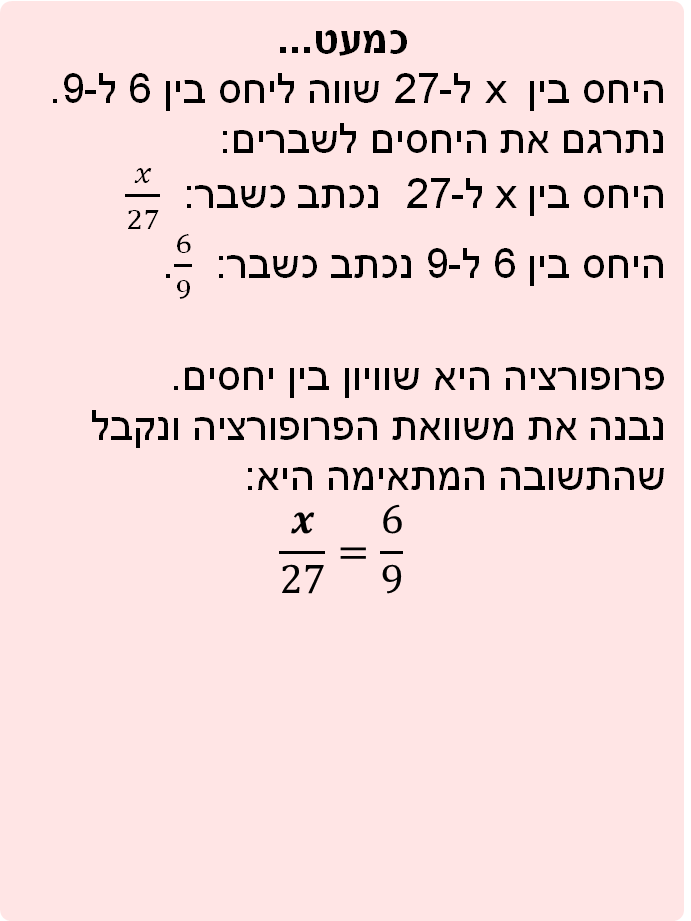
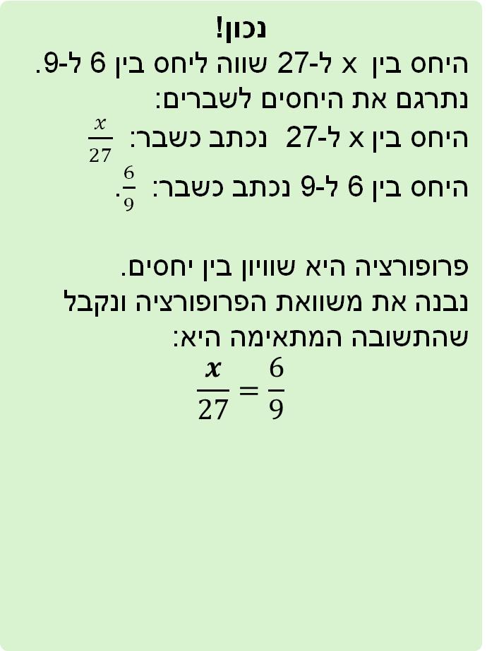

# שקף 41

**תבנית:** SingleChoiceQuestionImage

## הנחיות הפקה (מתוך הערות השקף)

- שם המסך בפיגמה:SingleChoiceQuestionImage
- מקטע זה מלווה בסרגל שאלה, שאלה 1 מתוך 4
- רמז יוצג מיד עם הצגת השאלה

## תוכן השקף

- צדקתי?
- היחס בין x ל-27 שווה ליחס בין 6 ל-9.
- א. סמנו את הפרופורציה (שוויון היחסים) המתאימה:
- אפשר רמז?
- חזרה
- זכרו:
- עליכם להקפיד שסדר המספרים במונה ובמכנה יהיה זהה בשני אגפי המשוואה.
- חזרה לשאלה
- נכון!
- היחס בין x  ל-27 שווה ליחס בין 6 ל-9.
- נתרגם את היחסים לשברים:
- היחס בין x ל-27  נכתב כשבר:
- היחס בין 6 ל-9 נכתב כשבר:  .
- פרופורציה היא שוויון בין יחסים.
- נבנה את משוואת הפרופורציה ונקבל שהתשובה המתאימה היא:
- כמעט...
- היחס בין x  ל-27 שווה ליחס בין 6 ל-9.
- נתרגם את היחסים לשברים:
- היחס בין x ל-27  נכתב כשבר:
- היחס בין 6 ל-9 נכתב כשבר:  .
- פרופורציה היא שוויון בין יחסים.
- נבנה את משוואת הפרופורציה ונקבל שהתשובה המתאימה היא:

## תמונות רפרנס

