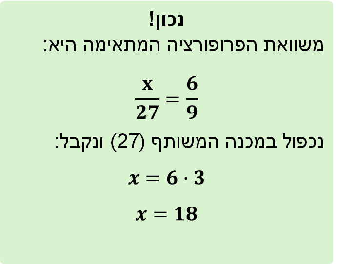
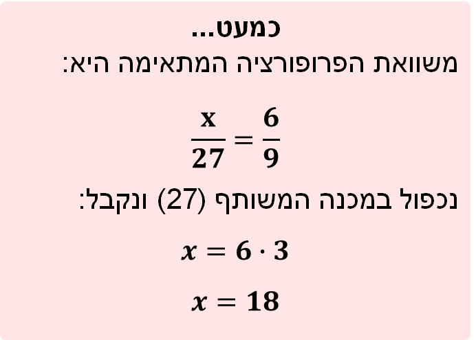

# שקף 42

**תבנית:** ValueInputQuestion

## הנחיות הפקה (מתוך הערות השקף)

- שם המסך בפיגמה:ValueInputQuestion
- מקטע זה מלווה בסרגל שאלה, שאלה 1 מתוך 4
- רמז יוצג מיד עם הצגת השאלה

## תוכן השקף

- צדקתי?
- היחס בין x ל-27 שווה ליחס בין 6 ל-9.
- מצאנו שהפרופורציה המתאימה היא
- ב. מצאו את x.
- אפשר רמז?
- חזרה
- ניתן לכפול במכנה המשותף (כפל בהצלבה) או לזהות את גורם ההרחבה של השבר.
- חזרה לשאלה
- נכון!
- משוואת הפרופורציה המתאימה היא:
- נכפול במכנה המשותף (27) ונקבל:
- כמעט...
- משוואת הפרופורציה המתאימה היא:
- נכפול במכנה המשותף (27) ונקבל:

## תמונות רפרנס

