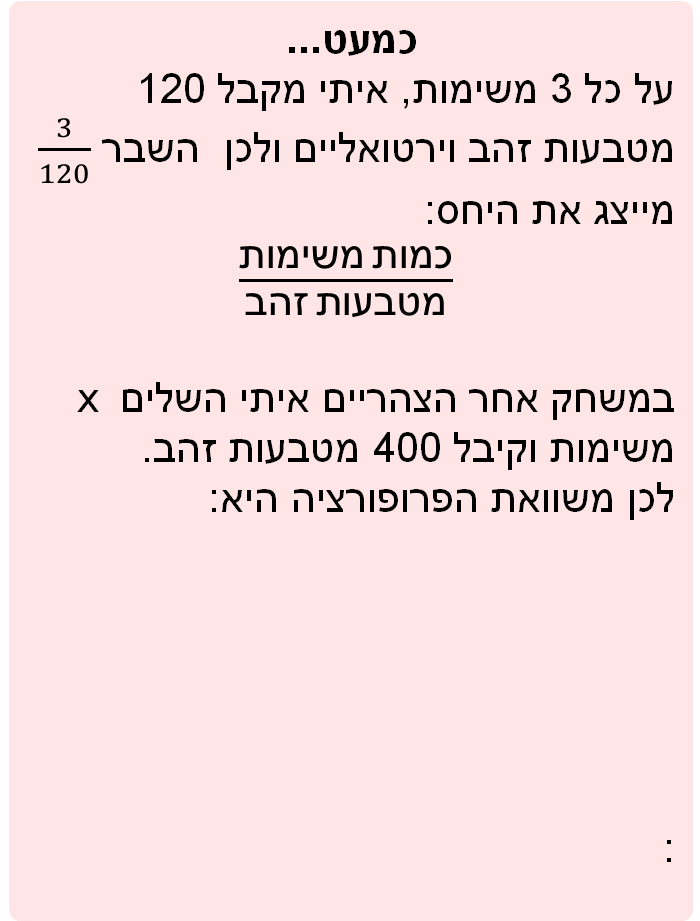
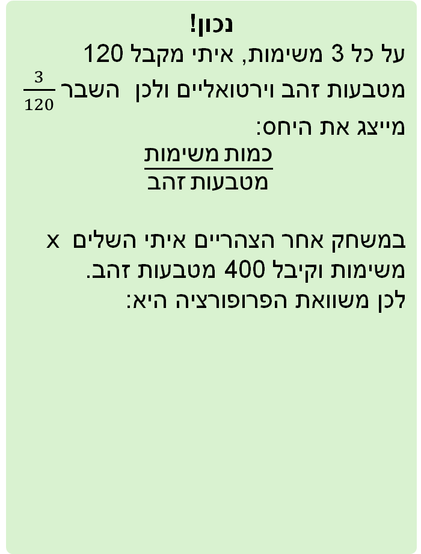

# שקף 43

**תבנית:** ValueInputQuestion

## הנחיות הפקה (מתוך הערות השקף)

- שם המסך בפיגמה:ValueInputQuestion
- מקטע זה מלווה בסרגל שאלה, שאלה 2 מתוך 4
- רמז יוצג מיד עם הצגת השאלה

## תוכן השקף

- צדקתי?
- במשחק מחשב, שחקן צובר 120 מטבעות זהב וירטואליים על כל 3 משימות שהוא משלים.
- איתי שיחק אחר הצהריים וראה שנצברו לזכותו 400 מטבעות, אבל לא זכר כמה משימות סיים בהצלחה.
- נסמן: x - כמות המשימות שאיתי סיים.
- א. השלימו את הפרופורציה (שוויון היחסים):
- אפשר רמז?
- חזרה
- העזרו בטבלת הפרופורציה:
- חזרה לשאלה
- נכון!
- על כל 3 משימות, איתי מקבל 120 מטבעות זהב וירטואליים ולכן  השבר  מייצג את היחס:
- במשחק אחר הצהריים איתי השלים x  משימות וקיבל 400 מטבעות זהב.
- לכן משוואת הפרופורציה היא:
- כמעט...
- על כל 3 משימות, איתי מקבל 120 מטבעות זהב וירטואליים ולכן  השבר  מייצג את היחס:
- במשחק אחר הצהריים איתי השלים x  משימות וקיבל 400 מטבעות זהב.
- לכן משוואת הפרופורציה היא:
- :

## תמונות רפרנס

