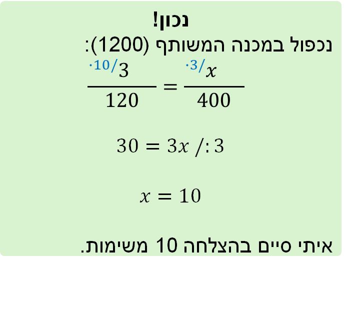
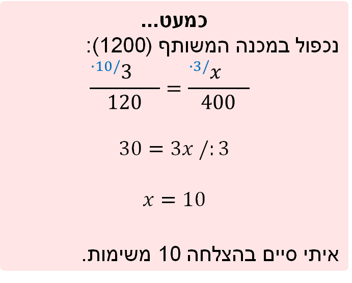

# שקף 44

**תבנית:** ValueInputQuestion

## הנחיות הפקה (מתוך הערות השקף)

- שם המסך בפיגמה:ValueInputQuestion
- מקטע זה מלווה בסרגל שאלה, שאלה 2 מתוך 4
- רמז יוצג מיד עם הצגת השאלה

## תוכן השקף

- צדקתי?
- במשחק מחשב, שחקן צובר 120 מטבעות זהב וירטואליים על כל 3 משימות שהוא משלים.
- איתי שיחק אחר הצהריים וראה שנצברו לזכותו 400 מטבעות, אבל לא זכר כמה משימות סיים בהצלחה.
- נסמן: x - כמות המשימות שאיתי סיים.
- מצאנו שהפרופורציה בין כמות המשימות שסיים לכמות מטבעות הזהב היא:
- ב. כמה משימות איתי השלים במשחק אחר הצהריים?
- אפשר רמז?
- חזרה
- כפלו במכנה המשותף כדי לפתור את המשוואה.
- חזרה לשאלה
- נכון!
- נכפול במכנה המשותף (1200):
- איתי סיים בהצלחה 10 משימות.
- כמעט...
- נכפול במכנה המשותף (1200):
- איתי סיים בהצלחה 10 משימות.

## תמונות רפרנס

