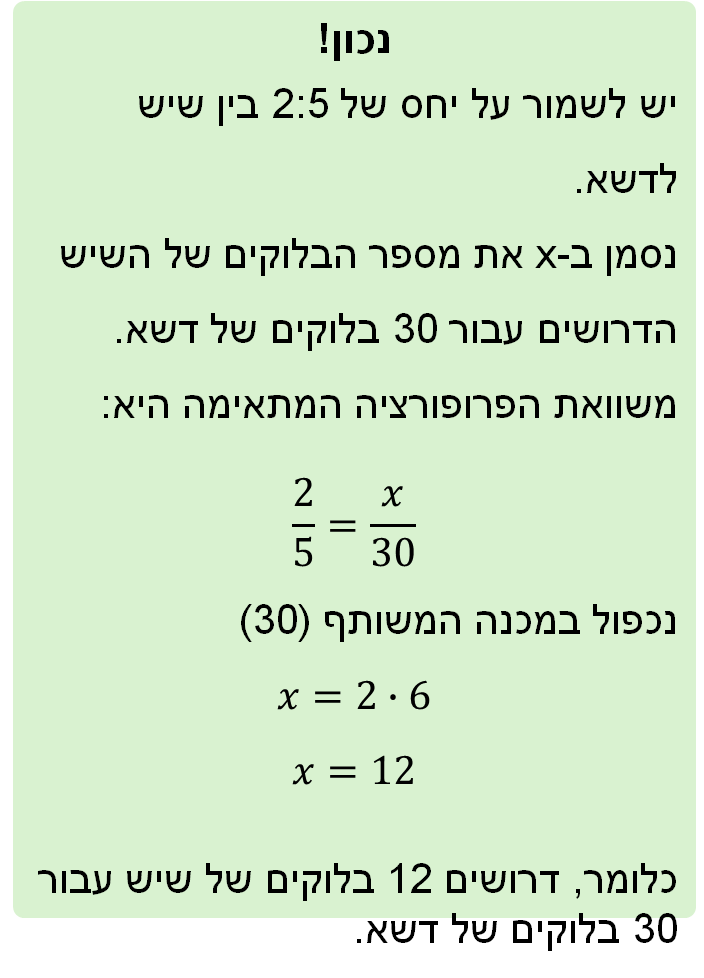
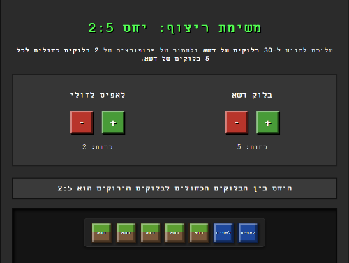
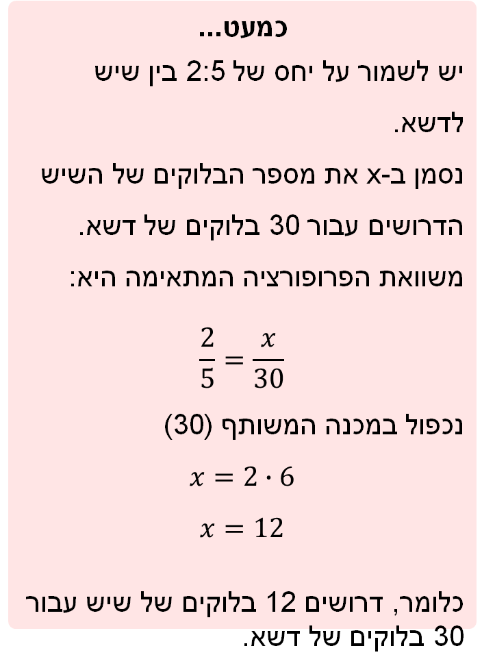

# שקף 45

**תבנית:** ValueInputQuestion

## הנחיות הפקה (מתוך הערות השקף)

- יישומון
- שם המסך בפיגמה:ValueInputQuestion
- רמז יוצג מיד עם הצגת השאלה
- מקטע זה מלווה בסרגל שאלה, שאלה 3 מתוך 4
- https://methodiccoil.sharepoint.com/Organization%20Data/Forms/AllItems.aspx?viewid=c026585c%2D8c56%2D4583%2D9790%2D8161b4c7c32b&ct=1783519175986&or=OWA%2DNT%2DMail&ga=1&id=%2FOrganization%20Data%2FFTP%2F%D7%9E%D7%A9%D7%A8%D7%93%20%D7%94%D7%97%D7%99%D7%A0%D7%95%D7%9A%2F720%2F%D7%AA%D7%A9%D7%A4%D7%96%2F%D7%9E%D7%AA%D7%9E%D7%98%D7%99%D7%A7%D7%94%2F02%5F%D7%A4%D7%A8%D7%95%D7%A4%D7%95%D7%A8%D7%A6%D7%99%D7%94%2F2%2E2%20%D7%9E%D7%A6%D7%99%D7%90%D7%AA%20%D7%94%D7%9E%D7%A1%D7%A4%D7%A8%20%D7%90%D7%99%D7%A7%D7%A1%20%D7%94%D7%97%D7%A1%D7%A8%20%28%D7%90%D7%91%D7%99%D7%98%D7%9C%29%2F%D7%AA%D7%95%D7%9B%D7%9F%20%D7%9E%D7%AA%D7%9E%D7%98%D7%99%2F%D7%A8%D7%99%D7%A6%D7%95%D7%A3%20%2D%20%D7%AA%D7%A8%D7%92%D7%95%D7%9C%20%D7%91%D7%A1%D7%99%D7%A1%D7%99%2Ehtml&parent=%2FOrganization%20Data%2FFTP%2F%D7%9E%D7%A9%D7%A8%D7%93%20%D7%94%D7%97%D7%99%D7%A0%D7%95%D7%9A%2F720%2F%D7%AA%D7%A9%D7%A4%D7%96%2F%D7%9E%D7%AA%D7%9E%D7%98%D7%99%D7%A7%D7%94%2F02%5F%D7%A4%D7%A8%D7%95%D7%A4%D7%95%D7%A8%D7%A6%D7%99%D7%94%2F2%2E2%20%D7%9E%D7%A6%D7%99%D7%90%D7%AA%20%D7%94%D7%9E%D7%A1%D7%A4%D7%A8%20%D7%90%D7%99%D7%A7%D7%A1%20%D7%94%D7%97%D7%A1%D7%A8%20%28%D7%90%D7%91%D7%99%D7%98%D7%9C%29%2F%D7%AA%D7%95%D7%9B%D7%9F%20%D7%9E%D7%AA%D7%9E%D7%98%D7%99

## תוכן השקף

- צדקתי?
- במשחק מחשב, אתם עובדים על ריצוף הכניסה למבצר שלכם.
- כדי ליצור דוגמה של בלוקים מעוצבים, אתם משתמשים ביחס קבוע של 2 בלוקים של שיש על כל 5 בלוקים של דשא.
- אם השתמשתם ב- 30 בלוקים של דשא,
- כמה בלוקים של שיש אתם צריכים
- כדי לשמור על יחס של 2:5?
- אפשר רמז?
- חזרה
- שימו לב!
- בנו משוואת פרופורציה שמתארת שוויון היחסים בין  כמות השיש לכמות הדשא.
- חזרה לשאלה
- נכון!
- יש לשמור על יחס של 2:5 בין שיש לדשא.
- נסמן בx- את מספר הבלוקים של השיש הדרושים עבור 30 בלוקים של דשא.
- משוואת הפרופורציה המתאימה היא:
- נכפול במכנה המשותף (30)
- כלומר, דרושים 12 בלוקים של שיש עבור 30 בלוקים של דשא.
- כמעט...
- יש לשמור על יחס של 2:5 בין שיש לדשא.
- נסמן בx- את מספר הבלוקים של השיש הדרושים עבור 30 בלוקים של דשא.
- משוואת הפרופורציה המתאימה היא:
- נכפול במכנה המשותף (30)
- כלומר, דרושים 12 בלוקים של שיש עבור 30 בלוקים של דשא.
- 12
- רמת חשיבה
- בלוקים

## תמונות רפרנס

