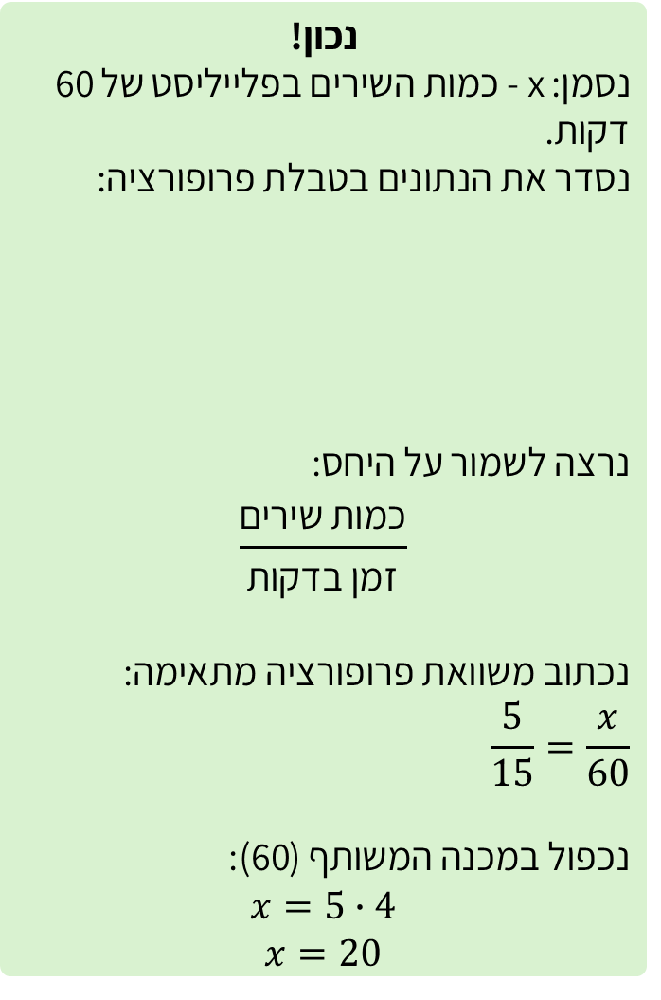
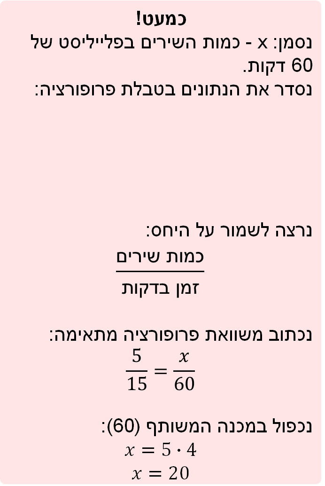

# שקף 46

**תבנית:** ValueInputQuestion

## הנחיות הפקה (מתוך הערות השקף)

- שם המסך בפיגמה:ValueInputQuestion
- מקטע זה מלווה בסרגל שאלה, שאלה 4 מתוך 4
- רמז יוצג מיד עם הצגת השאלה

## תוכן השקף

- צדקתי?
- אורי מכין פלייליסט של שירים אהובים לשמיעה בזמן הליכה.
- הוא שם לב שכל 5 שירים בפלייליסט אורכים יחד בדיוק 15 דקות של השמעה.
- אורי רוצה להכין פלייליסט שיימשך 60 דקות (שעה אחת).
- אם קצב ההשמעה נשאר זהה, כמה שירים צריכים להיות בפלייליסט?
- אפשר רמז?
- חזרה
- סמנו ב-x את מספר השירים בפלייליסט שאורך 60 דקות,
- והעזרו בטבלת הפרופורציה הבאה:
- חזרה לשאלה
- נכון!
- נסמן: x - כמות השירים בפלייליסט של 60 דקות.
- נסדר את הנתונים בטבלת פרופורציה:
- נרצה לשמור על היחס:
- נכתוב משוואת פרופורציה מתאימה:
- נכפול במכנה המשותף (60):
- כמעט!
- נסמן: x - כמות השירים בפלייליסט של 60 דקות.
- נסדר את הנתונים בטבלת פרופורציה:
- נרצה לשמור על היחס:
- נכתוב משוואת פרופורציה מתאימה:
- נכפול במכנה המשותף (60):
- כמות שירים
- זמן השמעה
- 5
- 15 דקות
- x
- 60 דקות
- כמות שירים
- זמן השמעה
- 5
- 15 דקות
- x
- 60 דקות
- כמות שירים
- זמן השמעה
- 5
- 15 דקות
- x
- 60 דקות

## תמונות רפרנס

