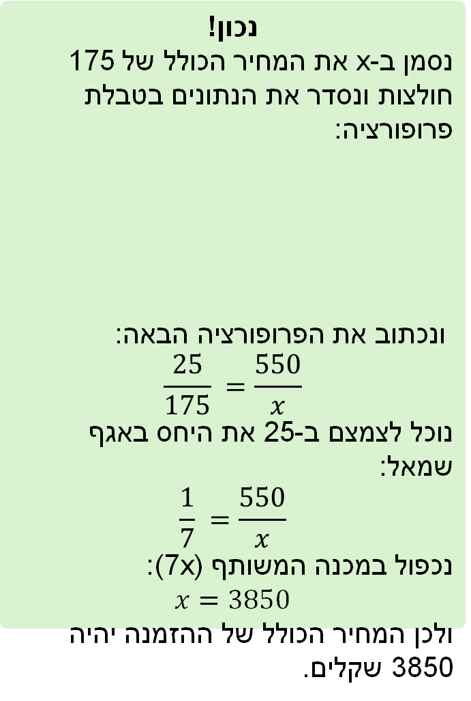
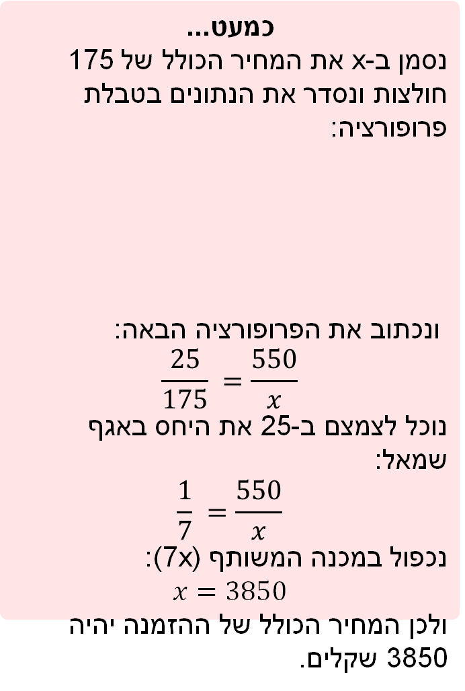

# שקף 48

**תבנית:** ValueInputQuestion

## הנחיות הפקה (מתוך הערות השקף)

- שם המסך בפיגמה:ValueInputQuestion
- מקטע זה מלווה בסרגל שאלה, שאלה 1 מתוך 2
- רמז בכל שאלה שיוצג רק לאחר ניסיון ראשון שגוי

## תוכן השקף

- לקראת הטיול השנתי, שכבת ח' מזמינה חולצות מודפסות לכל תלמידות ותלמידי השכבה.
- בית דפוס מקומי נתן להם הצעת מחיר: 25 חולצות ב-550 ₪.
- בשכבה 175 תלמידים.
- כמה שקלים תעלה ההזמנה כולה?
- צדקתי?
- אפשר רמז?
- חזרה
- בדקו:
- פי כמה גדול מספר התלמידים בשכבה ממספר החולצות שבהצעה המקורית?
- חזרה לשאלה
- נכון!
- נסמן ב-x את המחיר הכולל של 175 חולצות ונסדר את הנתונים בטבלת פרופורציה:
- ונכתוב את הפרופורציה הבאה:
- נוכל לצמצם ב-25 את היחס באגף שמאל:
- נכפול במכנה המשותף (7x):
- ולכן המחיר הכולל של ההזמנה יהיה 3850 שקלים.
- כמעט...
- נסמן ב-x את המחיר הכולל של 175 חולצות ונסדר את הנתונים בטבלת פרופורציה:
- ונכתוב את הפרופורציה הבאה:
- נוכל לצמצם ב-25 את היחס באגף שמאל:
- נכפול במכנה המשותף (7x):
- ולכן המחיר הכולל של ההזמנה יהיה 3850 שקלים.
- 3850
- הצעת מחיר
- ההזמנה כולה
- כמות חולצות
- 25
- 175
- מחיר (₪)
- 550
- x
- הצעת מחיר
- ההזמנה כולה
- כמות חולצות
- 25
- 175
- מחיר (₪)
- 550
- x
- ₪

## תמונות רפרנס

