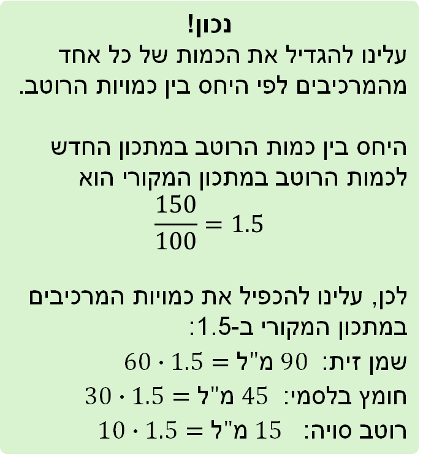
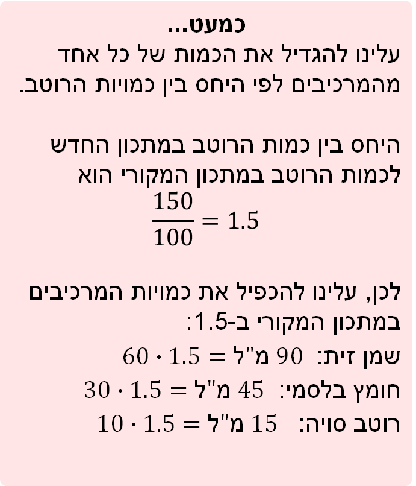

# שקף 49

**תבנית:** ValueInputQuestion

## הנחיות הפקה (מתוך הערות השקף)

- שם המסך בפיגמה:ValueInputQuestion
- מקטע זה מלווה בסרגל שאלה, שאלה 2 מתוך 2
- רמז בכל שאלה שיוצג רק לאחר ניסיון ראשון שגוי

## תוכן השקף

- להכנת רוטב לסלט יש לערבב את המרכיבים עבור 100 מ"ל רוטב:
- השלימו:
- כדי להכין כמות של 150 מ"ל רוטב לסלט, יש לערבב:
- צדקתי?
- אפשר רמז?
- חזרה
- חשבו:
- מה היחס בין כמות הרוטב במתכון החדש לכמות הרוטב במתכון המקורי?
- חזרה לשאלה
- נכון!
- עלינו להגדיל את הכמות של כל אחד מהמרכיבים לפי היחס בין כמויות הרוטב.
- היחס בין כמות הרוטב במתכון החדש לכמות הרוטב במתכון המקורי הוא
- לכן, עלינו להכפיל את כמויות המרכיבים במתכון המקורי ב-1.5:
- שמן זית:
- חומץ בלסמי:
- רוטב סויה:
- כמעט...
- עלינו להגדיל את הכמות של כל אחד מהמרכיבים לפי היחס בין כמויות הרוטב.
- היחס בין כמות הרוטב במתכון החדש לכמות הרוטב במתכון המקורי הוא
- לכן, עלינו להכפיל את כמויות המרכיבים במתכון המקורי ב-1.5:
- שמן זית:
- חומץ בלסמי:
- רוטב סויה:
- 90
- מרכיב
- כמות
- שמן זית
- 60 מ"ל
- חומץ בלסמי
- 30 מ"ל
- רוטב סויה
- 10 מ"ל
- 45
- 15
- מ"ל שמן זית
- מ"ל חומץ בלסמי
- מ"ל רוטב סויה

## תמונות רפרנס

