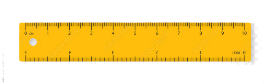

# שקף 52

**תבנית:** ValueInputQuestion

## הנחיות הפקה (מתוך הערות השקף)

- שם המסך בפיגמה:ValueInputQuestion
- אבל שימו לב שאין משוב. המשך פעיל ברגע שמקלידים ערך.

## תוכן השקף

- משימת כיתה
- מצאו חבר או חברה הנמצאים באותו שלב בלמידה. לא מצאתם? תוכלו לבצע את המשימה לבד.
- העזרים הדרושים: סרגל, כלי כתיבה ודף משבצות.
- נכיר את הסרגלהתבוננו בסרגל שלכם.
- הקווים שעל הסרגל נקראים שנתות.
- כל שנתה גדולה מייצגת 1 סנטימטר.
- כל שנתה קטנה מייצגת1  מילימטר.
- ספרו כמה שנתות קטנות יש בין 0  ל-1 ס"מ.
- כמה מילימטרים יש בסנטימטר אחד?
- רגע, יש פה מלא קווים קטנים... בואו נספור!
- 10
- מ"מ.
- מתבונן בזכוכית מגדלת

## תמונות רפרנס

