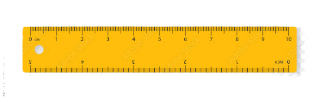

# שקף 54

**תבנית:** ValueInputQuestion

## הנחיות הפקה (מתוך הערות השקף)

- שם המסך בפיגמה:ValueInputQuestion
- אבל שימו לב שאין משוב. המשך פעיל ברגע שמקלידים ערך.

## תוכן השקף

- מצאו חבר או חברה הנמצאים באותו שלב בלמידה. לא מצאתם? תוכלו לבצע את המשימה לבד.
- העזרים הדרושים: סרגל, כלי כתיבה ודף משבצות.
- נכיר את הסרגלהתבוננו בסרגל שלכם.
- הקווים שעל הסרגל נקראים שנתות.
- כל שנתה גדולה מייצגת 1 סנטימטר.
- כל שנתה קטנה מייצגת1  מילימטר.
- אם אורך של חפץ מסוים הוא 450 מ"מ, מה יהיה אורכו בסנטימטרים?
- משימת כיתה
- 45
- ס"מ.

## תמונות רפרנס

