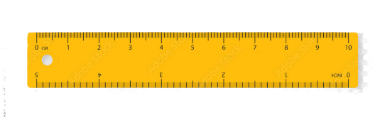

# שקף 55

**תבנית:** ValueInputQuestion

## הנחיות הפקה (מתוך הערות השקף)

- שם המסך בפיגמה:ValueInputQuestion
- אבל שימו לב שאין משוב. המשך פעיל ברגע שמקלידים ערך.

## תוכן השקף

- מצאו חבר או חברה הנמצאים באותו שלב בלמידה. לא מצאתם? תוכלו לבצע את המשימה לבד.
- העזרים הדרושים: סרגל, כלי כתיבה ודף משבצות.
- התבוננו בסרגל בחלק של האינצ'ים
- יתכן שהוא מופיע בצידו השני של הסרגל או כקו מקביל לקו הסנטימטרים (ראו תמונה).
- שרטטו במחברתכם קטע באורך 5 אינצ'ים.
- מדדו את אורך הקטע בסנטימטרים –
- דייקו ככל הניתן.
- 5 אינצ'ים שווים ל-                             סנטימטרים.
- משימת כיתה
- 12.7

## תמונות רפרנס

