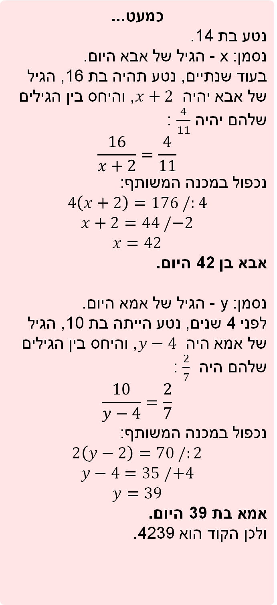
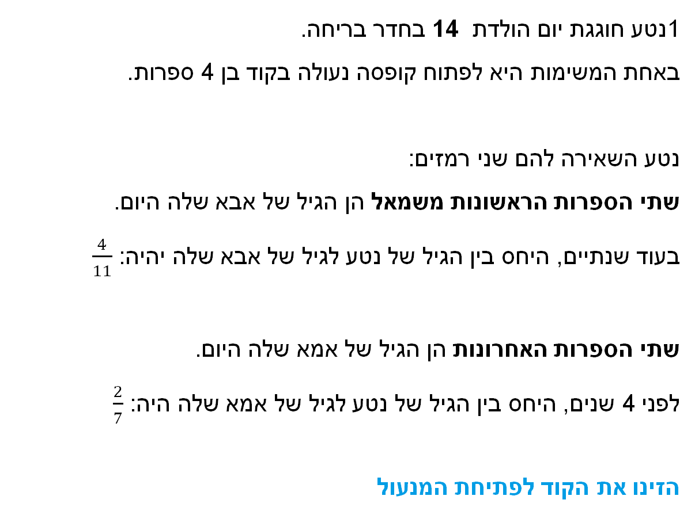
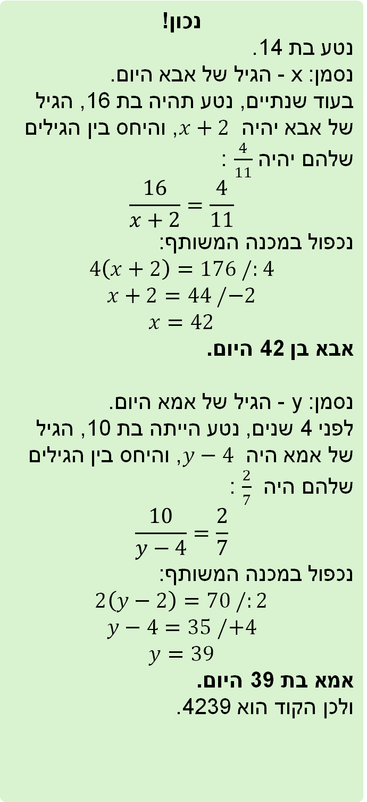

# שקף 61

**תבנית:** ValueInputQuestion

## הנחיות הפקה (מתוך הערות השקף)

- יישומון
- שם המסך בפיגמה:ValueInputQuestion
- רמז יוצג אחרי ניסיון 1
- מקטע זה מלווה בסרגל שאלה, שאלה 1 מתוך5

## תוכן השקף

- 1נטע חוגגת יום הולדת  14 בחדר בריחה.באחת המשימות היא לפתוח קופסה נעולה בקוד בן 4 ספרות.
- נטע השאירה להם שני רמזים:
- שתי הספרות הראשונות משמאל הן הגיל של אבא שלה היום.בעוד שנתיים, היחס בין הגיל של נטע לגיל של אבא שלה יהיה:
- שתי הספרות האחרונות הן הגיל של אמא שלה היום.לפני 4 שנים, היחס בין הגיל של נטע לגיל של אמא שלה היה:
- הזינו את הקוד לפתיחת המנעול
- צדקתי?
- אפשר רמז?
- חזרה
- שימו לב
- אם נסמן ב-x את הגיל של אבא היום, מה יהיה גילו בעוד שנתיים? והגיל של נטע? השלימו את הפרופורציה המתאימה.
- אם נסמן ב-y את הגיל של אמא היום, מה היה גילה לפני 4 שנים? והגיל של נטע? השלימו את הפרופורציה המתאימה.
- חזרה לשאלה
- נכון!
- נטע בת 14.
- נסמן: x - הגיל של אבא היום.
- בעוד שנתיים, נטע תהיה בת 16, הגיל של אבא יהיה  , והיחס בין הגילים שלהם יהיה  :
- נכפול במכנה המשותף:
- אבא בן 42 היום.
- נסמן: y - הגיל של אמא היום.
- לפני 4 שנים, נטע הייתה בת 10, הגיל של אמא היה  , והיחס בין הגילים שלהם היה   :
- נכפול במכנה המשותף:
- אמא בת 39 היום.
- ולכן הקוד הוא 4239.
- כמעט...
- נטע בת 14.
- נסמן: x - הגיל של אבא היום.
- בעוד שנתיים, נטע תהיה בת 16, הגיל של אבא יהיה  , והיחס בין הגילים שלהם יהיה  :
- נכפול במכנה המשותף:
- אבא בן 42 היום.
- נסמן: y - הגיל של אמא היום.
- לפני 4 שנים, נטע הייתה בת 10, הגיל של אמא היה  , והיחס בין הגילים שלהם היה   :
- נכפול במכנה המשותף:
- אמא בת 39 היום.
- ולכן הקוד הוא 4239.
- רמת חשיבה
- 4239

## תמונות רפרנס

