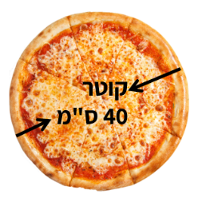
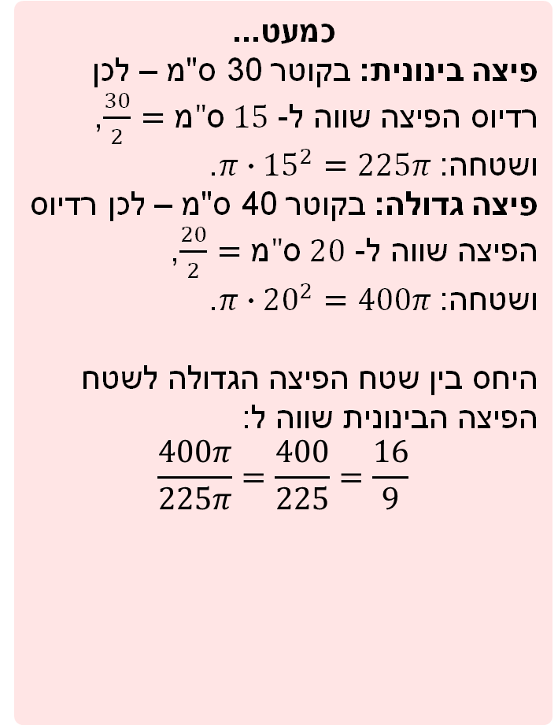
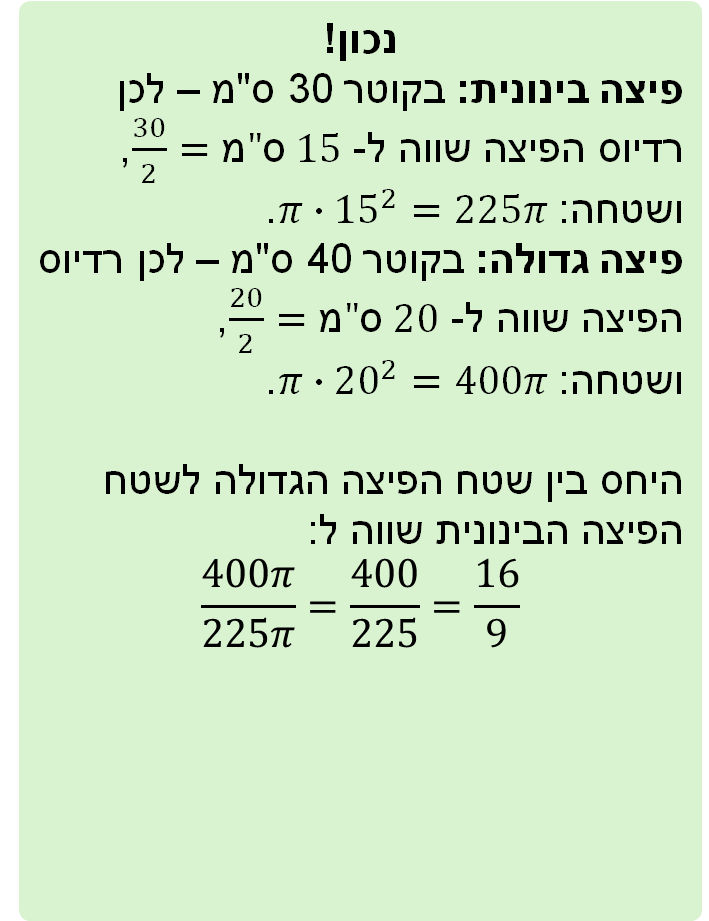

# שקף 62

**תבנית:** SingleChoiceQuestion

## הנחיות הפקה (מתוך הערות השקף)

- שם המסך בפיגמה: SingleChoiceQuestion
- רמז יוצג אחרי ניסיון 1
- מקטע זה מלווה בסרגל שאלה, שאלה 2 מתוך5

## תוכן השקף

- צדקתי?
- פיצרייה מגישה שתי פיצות עגולות בעלות אותו עובי אך בגדלים שונים.
- נתנאל ורוני מתווכחים ביניהם איזו פיצה משתלמת יותר לקנייה:
- פיצה בינונית: קוטר 30 ס"מ, מחיר 30 שקלים.
- פיצה גדולה:  קוטר 40 ס"מ, מחיר 40 שקלים.
- א. היחס בין שטח הפיצה הגדולה לבין שטח הפיצה הבינונית הוא:
- 4:3
- 15:4
- 16:9
- 3:2
- אפשר רמז?
- חזרה
- שימו לב:
- אורך הקוטר שווה לפעמיים רדיוס המעגל.
- שטח עיגול בעל רדיוס R שווה ל-  .
- לשם נוחות, ניתן להשתמש ב- .
- חזרה לשאלה
- נכון!
- פיצה בינונית: בקוטר 30 ס"מ – לכן רדיוס הפיצה שווה ל- ,
- ושטחה: .
- פיצה גדולה: בקוטר 40 ס"מ – לכן רדיוס הפיצה שווה ל- ,
- ושטחה: .
- היחס בין שטח הפיצה הגדולה לשטח הפיצה הבינונית שווה ל:
- כמעט...
- פיצה בינונית: בקוטר 30 ס"מ – לכן רדיוס הפיצה שווה ל- ,
- ושטחה: .
- פיצה גדולה: בקוטר 40 ס"מ – לכן רדיוס הפיצה שווה ל- ,
- ושטחה: .
- היחס בין שטח הפיצה הגדולה לשטח הפיצה הבינונית שווה ל:

## תמונות רפרנס

