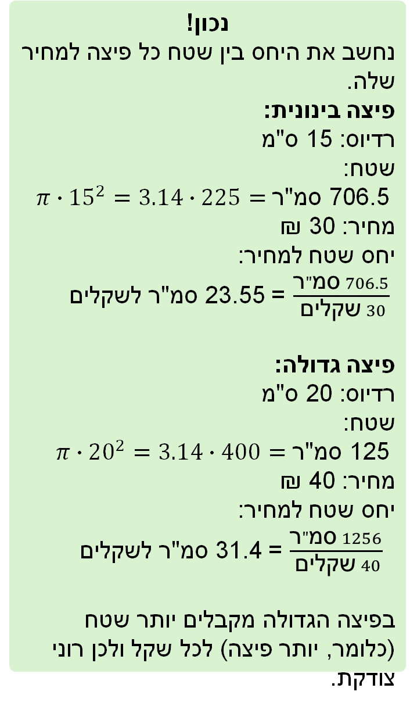
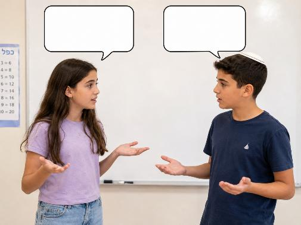
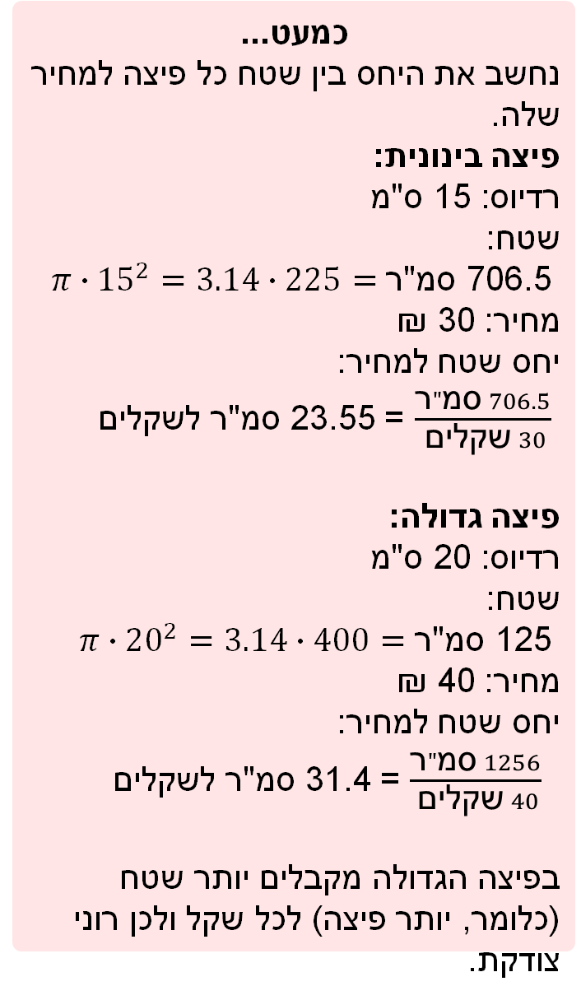

# שקף 63

**תבנית:** SingleChoiceQuestion

## הנחיות הפקה (מתוך הערות השקף)

- שם המסך בפיגמה: SingleChoiceQuestion
- רמז יוצג אחרי ניסיון 1
- מקטע זה מלווה בסרגל שאלה, שאלה 2 מתוך5
- תמונה לא מחייבת של שני ילדים מתווכחים עם הטקסט

## תוכן השקף

- צדקתי?
- פיצרייה מגישה שתי פיצות עגולות בעלות אותו עובי אך בגדלים שונים.
- נתנאל ורוני מתווכחים ביניהם איזו פיצה משתלמת יותר לקנייה:
- פיצה בינונית: קוטר 30 ס"מ, מחיר 30 שקלים.
- פיצה גדולה:  קוטר 40 ס"מ, מחיר 40 שקלים.
- ב. מי צודק?
- נתנאל
- רוני
- אף אחד
- אפשר רמז?
- חזרה
- חשבו
- כמה שטח פיצה מקבלים לכל שקל עבור כל אחת מהפיצות?
- חזרה לשאלה
- נכון!
- נחשב את היחס בין שטח כל פיצה למחיר שלה.
- פיצה בינונית:
- רדיוס: 15 ס"מ
- שטח:
- 706.5 סמ"ר
- מחיר: 30 ₪
- יחס שטח למחיר:
- = 23.55 סמ"ר לשקלים
- פיצה גדולה:
- רדיוס: 20 ס"מ
- שטח:
- 125 סמ"ר
- מחיר: 40 ₪
- יחס שטח למחיר:
- = 31.4 סמ"ר לשקלים
- בפיצה הגדולה מקבלים יותר שטח (כלומר, יותר פיצה) לכל שקל ולכן רוני צודקת.
- כמעט...
- נחשב את היחס בין שטח כל פיצה למחיר שלה.
- פיצה בינונית:
- רדיוס: 15 ס"מ
- שטח:
- 706.5 סמ"ר
- מחיר: 30 ₪
- יחס שטח למחיר:
- = 23.55 סמ"ר לשקלים
- פיצה גדולה:
- רדיוס: 20 ס"מ
- שטח:
- 125 סמ"ר
- מחיר: 40 ₪
- יחס שטח למחיר:
- = 31.4 סמ"ר לשקלים
- בפיצה הגדולה מקבלים יותר שטח (כלומר, יותר פיצה) לכל שקל ולכן רוני צודקת.
- שתי הפיצות משתלמות באותה מידה!
- קוטר הפיצה הבינונית הוא 30 ס"מ והמחיר הוא 30 ש"ח,
- קוטר הפיצה הגדולה הוא 40 ס"מ והמחיר הוא 40 ₪.
- בשני המקרים היחס בין הקוטר למחיר הוא 1 ל-1, ולכן אין הבדל.
- הפיצה הגדולה משתלמת יותר, כי היחס בין שטח הפיצה הגדולה למחיר שלה גדול מהיחס בין שטח הפיצה הבינונית למחיר שלה

## תמונות רפרנס

