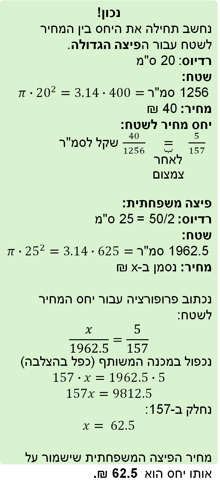
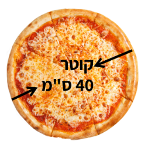
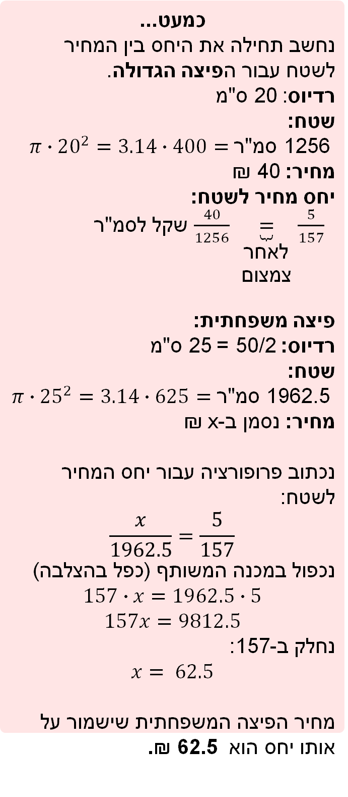

# שקף 64

**תבנית:** ValueInputQuestion

## הנחיות הפקה (מתוך הערות השקף)

- יישומון
- שם המסך בפיגמה:ValueInputQuestion
- רמז יוצג אחרי ניסיון 1
- מקטע זה מלווה בסרגל שאלה, שאלה 2 מתוך5

## תוכן השקף

- פיצרייה מגישה שתי פיצות עגולות בעלות אותו עובי אך בגדלים שונים.
- פיצה בינונית: בקוטר 30 ס"מ ובמחיר 30 שקלים.
- פיצה גדולה: בקוטר 40 ס"מ ובמחיר 40 שקלים.
- פיצה משפחתית חדשה עומדת לצאת לשוק.
- הפיצרייה רוצה לשמור על אותו יחס מחיר לשטח כמו של הפיצה הגדולה.
- ג. אם קוטר הפיצה המשפחתית הוא 50 ס"מ,
- כמה היא צריכה לעלות?
- צדקתי?
- אפשר רמז?
- חזרה
- מה יחס המחיר לשטח עבור הפיצה הגדולה?
- מה צריך להיות מחיר הפיצה המשפחתית כך שהיחס ישמר?
- חזרה לשאלה
- נכון!
- נחשב תחילה את היחס בין המחיר לשטח עבור הפיצה הגדולה.
- רדיוס: 20 ס"מ
- שטח:
- 1256 סמ"ר
- מחיר: 40 ₪
- יחס מחיר לשטח:
- שקל לסמ"ר
- פיצה משפחתית:
- רדיוס: 50/2 = 25 ס"מ
- שטח:
- 1962.5 סמ"ר
- מחיר: נסמן ב-x ₪
- נכתוב פרופורציה עבור יחס המחיר לשטח:
- נכפול במכנה המשותף (כפל בהצלבה)
- נחלק ב-157:
- מחיר הפיצה המשפחתית שישמור על אותו יחס הוא 62.5  ₪.
- כמעט...
- נחשב תחילה את היחס בין המחיר לשטח עבור הפיצה הגדולה.
- רדיוס: 20 ס"מ
- שטח:
- 1256 סמ"ר
- מחיר: 40 ₪
- יחס מחיר לשטח:
- שקל לסמ"ר
- פיצה משפחתית:
- רדיוס: 50/2 = 25 ס"מ
- שטח:
- 1962.5 סמ"ר
- מחיר: נסמן ב-x ₪
- נכתוב פרופורציה עבור יחס המחיר לשטח:
- נכפול במכנה המשותף (כפל בהצלבה)
- נחלק ב-157:
- מחיר הפיצה המשפחתית שישמור על אותו יחס הוא 62.5  ₪.
- רמת חשיבה
- 62.5
- ₪

## תמונות רפרנס

