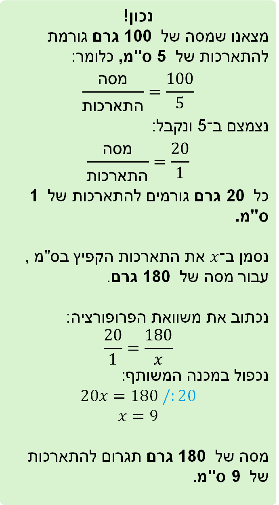
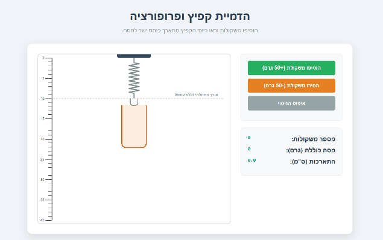
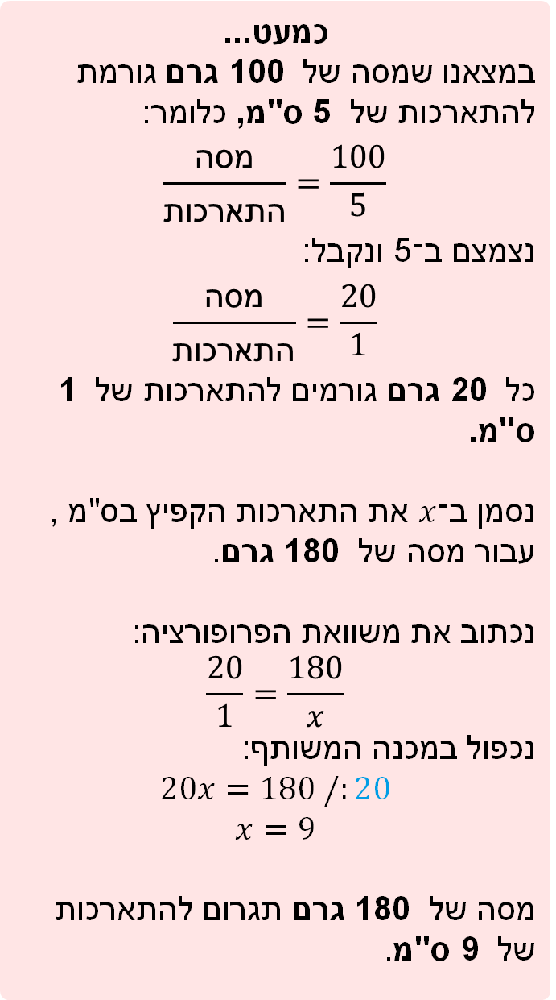

# שקף 66

**תבנית:** ValueInputQuestion

## הנחיות הפקה (מתוך הערות השקף)

- יישומון
- שם המסך בפיגמה:ValueInputQuestion
- רמז יוצג אחרי ניסיון 1
- מקטע זה מלווה בסרגל שאלה, שאלה 4 מתוך5
- להוסיף בפופ אפ לצד "הקפיץ מתארך" במשפט הראשון את הטקסט הבא:  חוק הוּק הוא חוק פיזיקלי המתאר את היחס בין כוח המופעל על קפיץ לבין מידת התארכות (או כיווץ) של הקפיץ.
- יחס זה נקרא קבוע הקפיץ ומתאר את גודל הכוח שיש להפעיל על קפיץ מסוים כדי לשנות את אורכו ביחידת אורך אחת.
- מקטע זה מלווה בסרגל שאלה, שאלה 4 מתוך5
- https://methodiccoil.sharepoint.com/Organization%20Data/Forms/AllItems.aspx?viewid=c026585c%2D8c56%2D4583%2D9790%2D8161b4c7c32b&ct=1783519175986&or=OWA%2DNT%2DMail&ga=1&id=%2FOrganization%20Data%2FFTP%2F%D7%9E%D7%A9%D7%A8%D7%93%20%D7%94%D7%97%D7%99%D7%A0%D7%95%D7%9A%2F720%2F%D7%AA%D7%A9%D7%A4%D7%96%2F%D7%9E%D7%AA%D7%9E%D7%98%D7%99%D7%A7%D7%94%2F02%5F%D7%A4%D7%A8%D7%95%D7%A4%D7%95%D7%A8%D7%A6%D7%99%D7%94%2F2%2E2%20%D7%9E%D7%A6%D7%99%D7%90%D7%AA%20%D7%94%D7%9E%D7%A1%D7%A4%D7%A8%20%D7%90%D7%99%D7%A7%D7%A1%20%D7%94%D7%97%D7%A1%D7%A8%20%28%D7%90%D7%91%D7%99%D7%98%D7%9C%29%2F%D7%AA%D7%95%D7%9B%D7%9F%20%D7%9E%D7%AA%D7%9E%D7%98%D7%99%2F%D7%A7%D7%A4%D7%99%D7%A5%2Ehtml&parent=%2FOrganization%20Data%2FFTP%2F%D7%9E%D7%A9%D7%A8%D7%93%20%D7%94%D7%97%D7%99%D7%A0%D7%95%D7%9A%2F720%2F%D7%AA%D7%A9%D7%A4%D7%96%2F%D7%9E%D7%AA%D7%9E%D7%98%D7%99%D7%A7%D7%94%2F02%5F%D7%A4%D7%A8%D7%95%D7%A4%D7%95%D7%A8%D7%A6%D7%99%D7%94%2F2%2E2%20%D7%9E%D7%A6%D7%99%D7%90%D7%AA%20%D7%94%D7%9E%D7%A1%D7%A4%D7%A8%20%D7%90%D7%99%D7%A7%D7%A1%20%D7%94%D7%97%D7%A1%D7%A8%20%28%D7%90%D7%91%D7%99%D7%98%D7%9C%29%2F%D7%AA%D7%95%D7%9B%D7%9F%20%D7%9E%D7%AA%D7%9E%D7%98%D7%99

## תוכן השקף

- ביישומון ניתן להוסיף או להסיר משקולות רק בקפיצות של 50 גרם.
- במציאות, ניתן לתלות על הקפיץ מסות בגדלים שונים.
- השלימו:
- היחס הקבוע בין המסה להתארכות הקפיץ הוא
- גרם לס"מ.
- ולכן מסה של 180 גרם גורמת להתארכות של
- ס"מ
- צדקתי?
- אפשר רמז?
- חזרה
- רמת חשיבה
- טקסט
- טקסט
- נכון!
- מצאנו שמסה של 100  גרם גורמת להתארכות של 5  ס"מ, כלומר:
- נצמצם ב־5 ונקבל:
- כל  20 גרם גורמים להתארכות של  1 ס"מ.
- נסמן ב־ את התארכות הקפיץ בס"מ , עבור מסה של 180  גרם.
- נכתוב את משוואת הפרופורציה:
- נכפול במכנה המשותף:
- מסה של 180  גרם תגרום להתארכות של 9  ס"מ.
- היעזרו בנתונים שמצאתם בסעיף הקודם:
- עבור מסה של 100 גרם, הקפיץ מתארך ב-5 ס"מ.
- חזרה לשאלה
- כמעט...
- במצאנו שמסה של 100  גרם גורמת להתארכות של 5  ס"מ, כלומר:
- נצמצם ב־5 ונקבל:
- כל  20 גרם גורמים להתארכות של  1 ס"מ.
- נסמן ב־ את התארכות הקפיץ בס"מ , עבור מסה של 180  גרם.
- נכתוב את משוואת הפרופורציה:
- נכפול במכנה המשותף:
- מסה של 180  גרם תגרום להתארכות של 9  ס"מ.
- 20
- 9

## תמונות רפרנס

