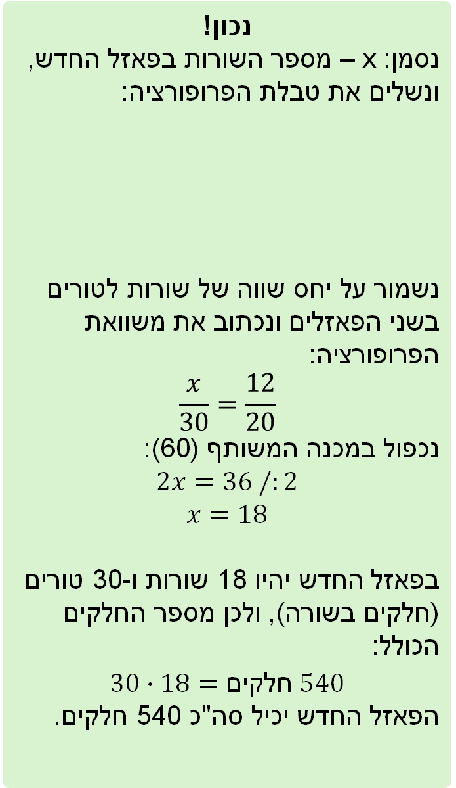
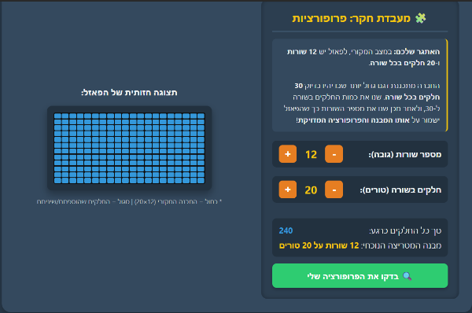
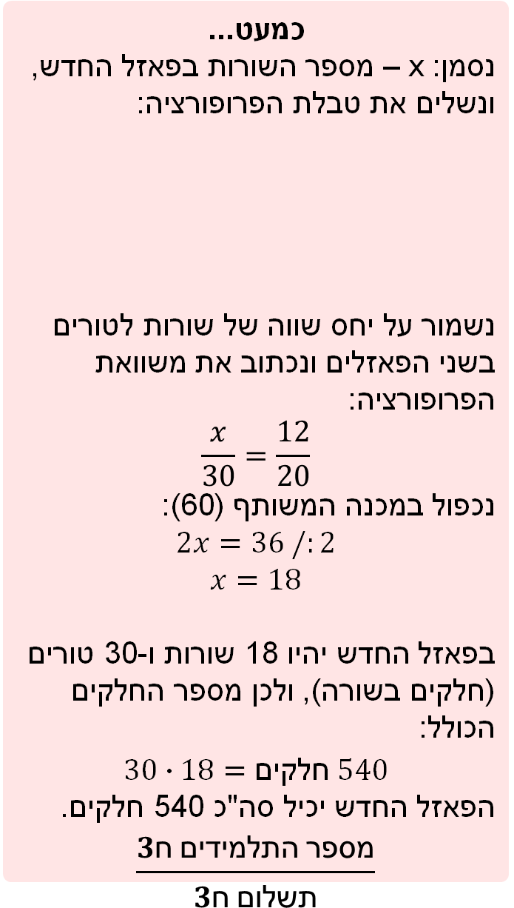

# שקף 67

**תבנית:** ValueInputQuestion

## הנחיות הפקה (מתוך הערות השקף)

- יישומון
- שם המסך בפיגמה:ValueInputQuestion
- רמז יוצג אחרי ניסיון 1
- להוסיף בפופ אפ לצד "הקפיץ מתארך" במשפט הראשון את הטקסט הבא:  חוק הוּק הוא חוק פיזיקלי המתאר את היחס בין כוח המופעל על קפיץ לבין מידת התארכות (או כיווץ) של הקפיץ.
- יחס זה נקרא קבוע הקפיץ ומתאר את גודל הכוח שיש להפעיל על קפיץ מסוים כדי לשנות את אורכו ביחידת אורך אחת.
- מקטע זה מלווה בסרגל שאלה, שאלה 5 מתוך5
- https://methodiccoil.sharepoint.com/Organization%20Data/Forms/AllItems.aspx?viewid=c026585c%2D8c56%2D4583%2D9790%2D8161b4c7c32b&ct=1783519175986&or=OWA%2DNT%2DMail&ga=1&id=%2FOrganization%20Data%2FFTP%2F%D7%9E%D7%A9%D7%A8%D7%93%20%D7%94%D7%97%D7%99%D7%A0%D7%95%D7%9A%2F720%2F%D7%AA%D7%A9%D7%A4%D7%96%2F%D7%9E%D7%AA%D7%9E%D7%98%D7%99%D7%A7%D7%94%2F02%5F%D7%A4%D7%A8%D7%95%D7%A4%D7%95%D7%A8%D7%A6%D7%99%D7%94%2F2%2E2%20%D7%9E%D7%A6%D7%99%D7%90%D7%AA%20%D7%94%D7%9E%D7%A1%D7%A4%D7%A8%20%D7%90%D7%99%D7%A7%D7%A1%20%D7%94%D7%97%D7%A1%D7%A8%20%28%D7%90%D7%91%D7%99%D7%98%D7%9C%29%2F%D7%AA%D7%95%D7%9B%D7%9F%20%D7%9E%D7%AA%D7%9E%D7%98%D7%99%2F%D7%99%D7%99%D7%A9%D7%95%D7%9E%D7%95%D7%9F%20%D7%A4%D7%90%D7%96%D7%9C%2Ehtml&parent=%2FOrganization%20Data%2FFTP%2F%D7%9E%D7%A9%D7%A8%D7%93%20%D7%94%D7%97%D7%99%D7%A0%D7%95%D7%9A%2F720%2F%D7%AA%D7%A9%D7%A4%D7%96%2F%D7%9E%D7%AA%D7%9E%D7%98%D7%99%D7%A7%D7%94%2F02%5F%D7%A4%D7%A8%D7%95%D7%A4%D7%95%D7%A8%D7%A6%D7%99%D7%94%2F2%2E2%20%D7%9E%D7%A6%D7%99%D7%90%D7%AA%20%D7%94%D7%9E%D7%A1%D7%A4%D7%A8%20%D7%90%D7%99%D7%A7%D7%A1%20%D7%94%D7%97%D7%A1%D7%A8%20%28%D7%90%D7%91%D7%99%D7%98%D7%9C%29%2F%D7%AA%D7%95%D7%9B%D7%9F%20%D7%9E%D7%AA%D7%9E%D7%98%D7%99

## תוכן השקף

- צדקתי?
- העזרו ביישומון.
- כמה חלקים סך הכל יכיל הפאזל החדש?
- אפשר רמז?
- חזרה
- רמת חשיבה
- טקסט
- טקסט
- נכון!
- נסמן: x – מספר השורות בפאזל החדש, ונשלים את טבלת הפרופורציה:
- נשמור על יחס שווה של שורות לטורים בשני הפאזלים ונכתוב את משוואת הפרופורציה:
- נכפול במכנה המשותף (60):
- בפאזל החדש יהיו 18 שורות ו-30 טורים (חלקים בשורה), ולכן מספר החלקים הכולל:
- הפאזל החדש יכיל סה"כ 540 חלקים.
- נסמן ב-x את התשלום הכולל על האולם, ונציב:
- מצאו תחילה כמה שורות יהיו בפאזל החדש,
- כך שישמר היחס המקורי בין אורך הפאזל לרוחב הפאזל.
- חזרה לשאלה
- כמעט...
- נסמן: x – מספר השורות בפאזל החדש, ונשלים את טבלת הפרופורציה:
- נשמור על יחס שווה של שורות לטורים בשני הפאזלים ונכתוב את משוואת הפרופורציה:
- נכפול במכנה המשותף (60):
- בפאזל החדש יהיו 18 שורות ו-30 טורים (חלקים בשורה), ולכן מספר החלקים הכולל:
- הפאזל החדש יכיל סה"כ 540 חלקים.
- 540
- פאזל חדש
- פאזל מקורי
- x
- 12
- שורות
- 30
- 20
- טורים
- פאזל חדש
- פאזל מקורי
- x
- 12
- שורות
- 30
- 20
- טורים
- חלקים

## תמונות רפרנס

