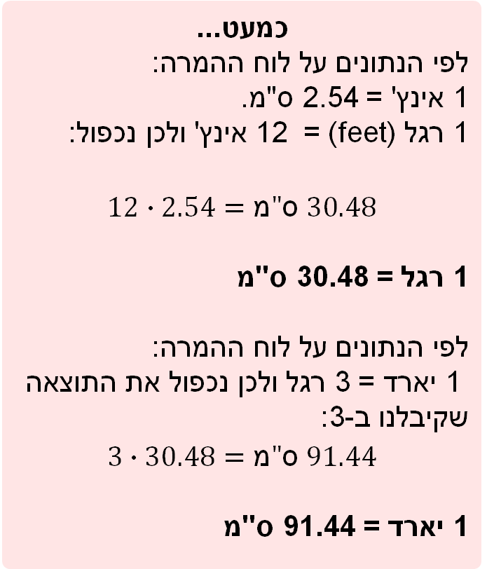
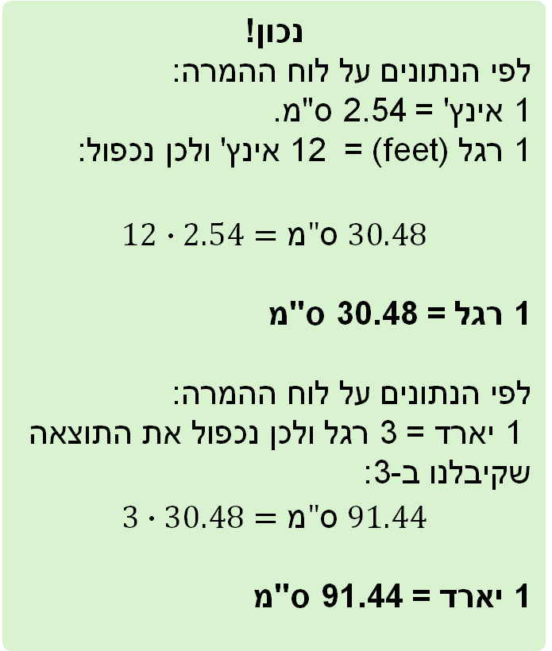
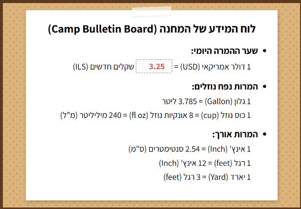

# שקף 72

**תבנית:** ValueInputQuestion

## הנחיות הפקה (מתוך הערות השקף)

- שם המסך בפיגמה:ValueInputQuestion
- רמז יוצג אחרי ניסיון 1
- אין צורך בסרגל התקדמות
- לעצב את הלוח מודעות

## תוכן השקף

- צדקתי?
- א. קבוצה של 15 תלמידי שכבת ח' נבחרה לייצג את ישראל במחנה קיץ ספורטיבי בינלאומי בארצות הברית.
- בכדי לעזור לתלמידים, המדריכים מעדכנים מידי יום את "לוח המידע של המחנה" הכולל נתונים שיקלו על ההתנהלות במדינה זרה.
- השתמשו במידע שעל הלוח כדי לענות על השאלות הבאות:
- 1. רגל (feet) שווה ל-                                 ס"מ
- 1. יארד (yard) שווה ל-                                ס"מ
- אפשר רמז?
- חזרה
- נכון!
- לפי הנתונים על לוח ההמרה:
- 1 אינץ' = 2.54 ס"מ.
- 1 רגל (feet) =  12 אינץ' ולכן נכפול:
- 1 רגל = 30.48 ס"מ
- לפי הנתונים על לוח ההמרה:
- 1 יארד = 3 רגל ולכן נכפול את התוצאה שקיבלנו ב-3:
- 1 יארד = 91.44 ס"מ
- שימו לב!
- אם נתון לכם ש-1 רגל = 12 אינץ', ו-1 יארד = 3 רגליים,
- עליכם להכפיל את הערכים כדי להגיע לערך של יארד אחד.
- חזרה לשאלה
- כמעט...
- לפי הנתונים על לוח ההמרה:
- 1 אינץ' = 2.54 ס"מ.
- 1 רגל (feet) =  12 אינץ' ולכן נכפול:
- 1 רגל = 30.48 ס"מ
- לפי הנתונים על לוח ההמרה:
- 1 יארד = 3 רגל ולכן נכפול את התוצאה שקיבלנו ב-3:
- 1 יארד = 91.44 ס"מ
- 30.48
- 91.44

## תמונות רפרנס

