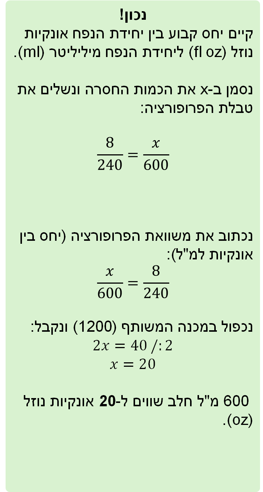
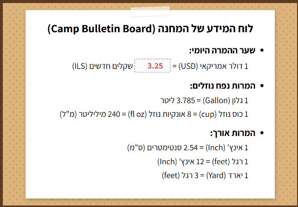
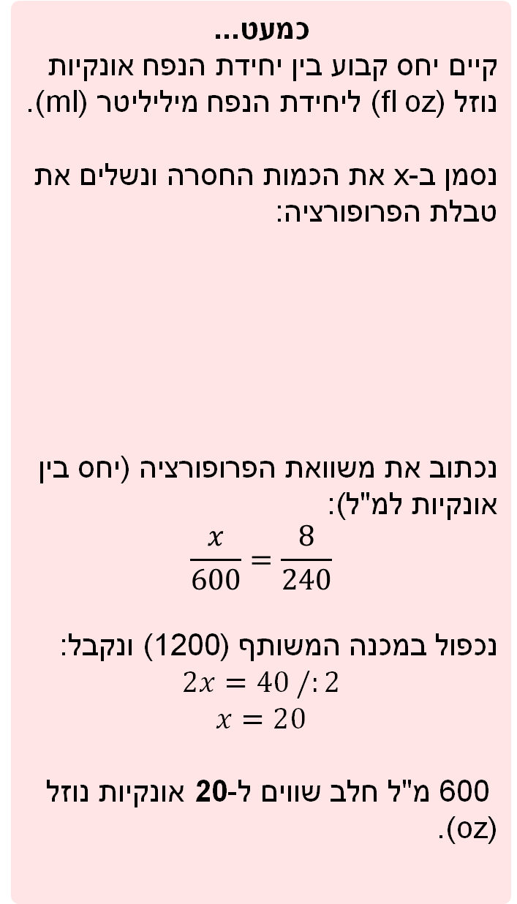

# שקף 73

**תבנית:** ValueInputQuestion

## הנחיות הפקה (מתוך הערות השקף)

- שם המסך בפיגמה:ValueInputQuestion
- רמז יוצג אחרי ניסיון 1
- אין צורך בסרגל התקדמות

## תוכן השקף

- צדקתי?
- ב. התלמידים מתכננים להכין פנקייקים עבור כל חברי הקבוצה. במתכון שלהם רשום שיש להוסיף 600 מ"ל חלב לבלילה.
- במטבח של המחנה ישנו רק כלי מדידה אחד שהשנתות עליו מסומנות באונקיות נוזל (oz) בלבד.
- כמה אונקיות חלב עליהם למדוד בכלי בכדי שהכמות
- תתאים לכמות במתכון?
- אפשר רמז?
- חזרה
- רמת חשיבה
- טקסט
- טקסט
- נכון!
- קיים יחס קבוע בין יחידת הנפח אונקיות נוזל (fl oz) ליחידת הנפח מיליליטר (ml).
- נסמן ב-x את הכמות החסרה ונשלים את טבלת הפרופורציה:
- נכתוב את משוואת הפרופורציה (יחס בין אונקיות למ"ל):
- נכפול במכנה המשותף (1200) ונקבל:
- 600  מ"ל חלב שווים ל-20 אונקיות נוזל (oz).
- קיים יחס קבוע בין יחידת הנפח אונקיות נוזל (fl oz) ליחידת הנפח מיליליטר (ml).
- היעזרו ביחס זה לכתיבת פרופורציה מתאימה.
- חזרה לשאלה
- כמעט...
- קיים יחס קבוע בין יחידת הנפח אונקיות נוזל (fl oz) ליחידת הנפח מיליליטר (ml).
- נסמן ב-x את הכמות החסרה ונשלים את טבלת הפרופורציה:
- נכתוב את משוואת הפרופורציה (יחס בין אונקיות למ"ל):
- נכפול במכנה המשותף (1200) ונקבל:
- 600  מ"ל חלב שווים ל-20 אונקיות נוזל (oz).
- 20
- מיליליטרים (מ"ל)
- אונקיות נוזל (fl oz)
- 240
- 8
- 600
- x
- מיליליטרים (מ"ל)
- אונקיות נוזל (fl oz)
- 240
- 8
- 600
- x
- oz

## תמונות רפרנס

## הערות תיקוף (PPTX comments)

- **Guest User** (resolved): דקלה - פסקה מאוד קשה להבנה. מילים קשות והמרות לא אינטואיטיביות
-   ↳ **Efrat Fridman**: שוכתב
