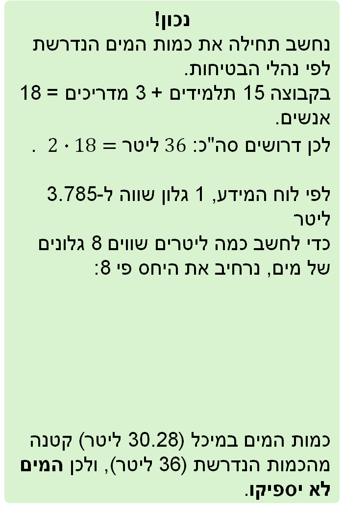
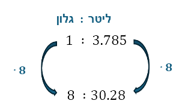
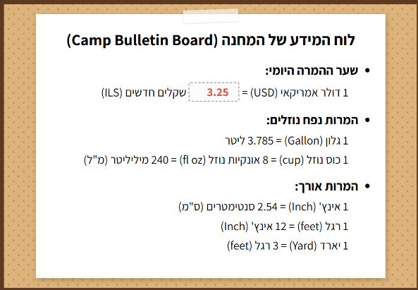
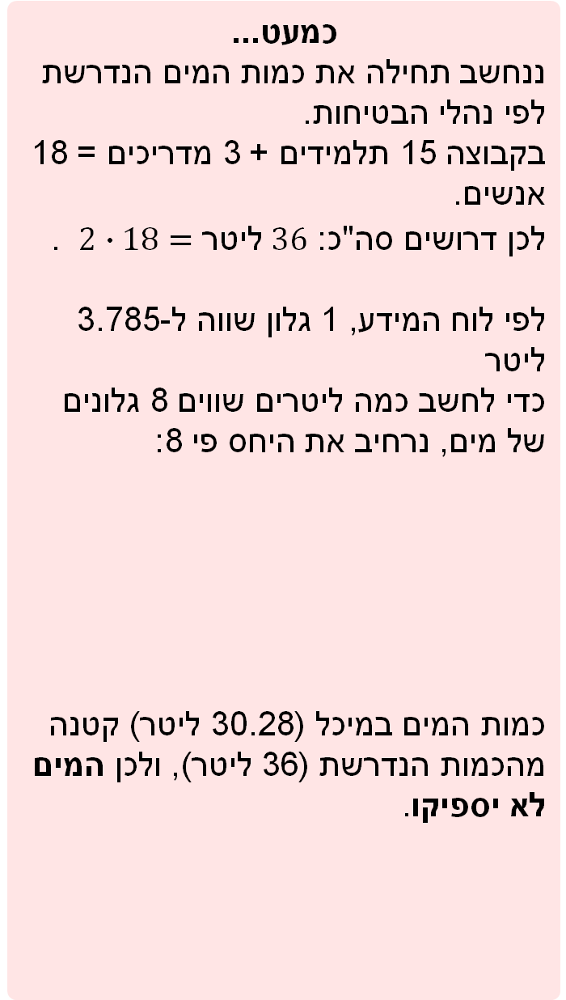

# שקף 74

**תבנית:** SingleChoiceQuestion

## הנחיות הפקה (מתוך הערות השקף)

- שם המסך בפיגמה: SingleChoiceQuestion
- רמז יוצג אחרי ניסיון 1
- אין צורך בסרגל התקדמות

## תוכן השקף

- צדקתי?
- ג. לקראת יום טיול בטבע, נהלי הבטיחות קובעים שכל אדם חייב לקחת עמו לפחות 2 ליטרים של מים לשתייה.
- לטיול יוצאים כל 15 התלמידים ועוד 3 מדריכים מלווים.
- לרשות הקבוצה הועמד מיכל מים מרכזי אחד שמכיל 8 גלונים של מים.
- האם כמות המים במיכל תספיק למילוי הבקבוקים של כל המשתתפים בהתאם לנהלי הבטיחות?
- אפשר רמז?
- חזרה
- רמת חשיבה
- טקסט
- טקסט
- נכון!
- נחשב תחילה את כמות המים הנדרשת לפי נהלי הבטיחות.
- בקבוצה 15 תלמידים + 3 מדריכים = 18 אנשים.
- לכן דרושים סה"כ:  .
- לפי לוח המידע, 1 גלון שווה ל-3.785 ליטר
- כדי לחשב כמה ליטרים שווים 8 גלונים של מים, נרחיב את היחס פי 8:
- כמות המים במיכל (30.28 ליטר) קטנה מהכמות הנדרשת (36 ליטר), ולכן המים לא יספיקו.
- חשבו:
- כמה ליטרים של מים נדרשים לפי נהלי הבטיחות עבור כל המשתתפים בטיול.
- השוואה ישירה בין כמות המים הנדרשת לכמות המים במיכל אפשרית רק כאשר הכמויות הן באותן יחידות מידה.
- חזרה לשאלה
- כמעט...
- ננחשב תחילה את כמות המים הנדרשת לפי נהלי הבטיחות.
- בקבוצה 15 תלמידים + 3 מדריכים = 18 אנשים.
- לכן דרושים סה"כ:  .
- לפי לוח המידע, 1 גלון שווה ל-3.785 ליטר
- כדי לחשב כמה ליטרים שווים 8 גלונים של מים, נרחיב את היחס פי 8:
- כמות המים במיכל (30.28 ליטר) קטנה מהכמות הנדרשת (36 ליטר), ולכן המים לא יספיקו.
- לא ניתן לדעת
- לא
- כן

## תמונות רפרנס

