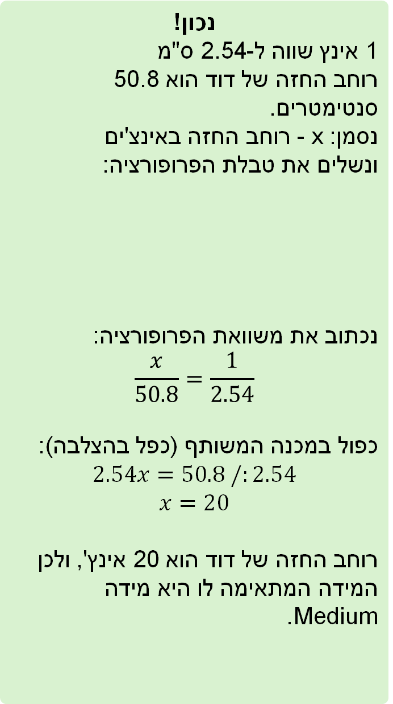
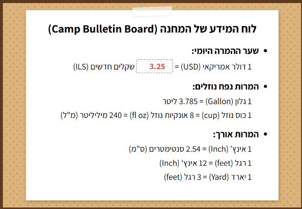
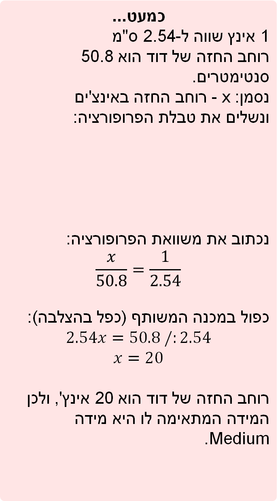

# שקף 75

**תבנית:** SingleChoiceQuestion

## הנחיות הפקה (מתוך הערות השקף)

- שם המסך בפיגמה: SingleChoiceQuestion
- רמז יוצג אחרי ניסיון 1
- אין צורך בסרגל התקדמות

## תוכן השקף

- צדקתי?
- ד. הקבוצה מזמינה חולצות ייצוגיות מחנות אמריקאית.
- כדי לבחור מידה, דויד מודד את רוחב החזה שלו ומקבל תוצאה של 50.8 ס"מ.
- בטבלת המידות של החנות, רוחב החזה מופיע באינצ׳ים.
- איזו מידת חולצה צריך דויד לבחור?
- אפשר רמז?
- חזרה
- רמת חשיבה
- טקסט
- טקסט
- נכון!
- 1 אינץ שווה ל-2.54 ס"מ
- רוחב החזה של דוד הוא 50.8 סנטימטרים.
- נסמן: x - רוחב החזה באינצ'ים
- ונשלים את טבלת הפרופורציה:
- נכתוב את משוואת הפרופורציה:
- כפול במכנה המשותף (כפל בהצלבה):
- רוחב החזה של דוד הוא 20 אינץ', ולכן המידה המתאימה לו היא מידה Medium.
- שימו לב:
- השתמשו בנתון מהלוח - אם 1 אינץ' שווה ל-2.54 ס"מ,
- איך נדע כמה אינצ'ים הם 50.8 ס"מ?
- חזרה לשאלה
- כמעט...
- 1 אינץ שווה ל-2.54 ס"מ
- רוחב החזה של דוד הוא 50.8 סנטימטרים.
- נסמן: x - רוחב החזה באינצ'ים
- ונשלים את טבלת הפרופורציה:
- נכתוב את משוואת הפרופורציה:
- כפול במכנה המשותף (כפל בהצלבה):
- רוחב החזה של דוד הוא 20 אינץ', ולכן המידה המתאימה לו היא מידה Medium.
- Large (22 אינץ' ומעלה)
- Medium (21-19 אינץ')
- Small (עד 18 אינץ')
- אורך בס"מ
- אורך באינץ'
- 2.54
- 1
- 50.8
- x
- אורך בס"מ
- אורך באינץ'
- 2.54
- 1
- 50.8
- x

## תמונות רפרנס

