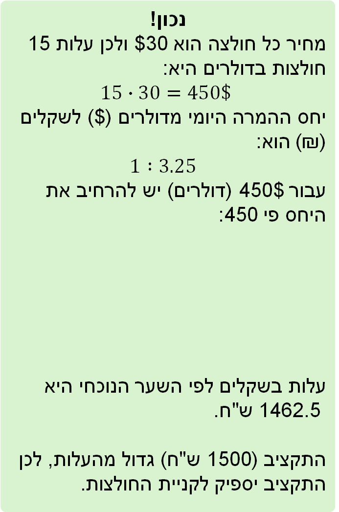
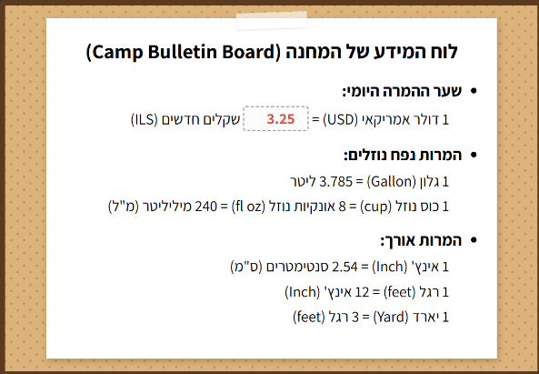
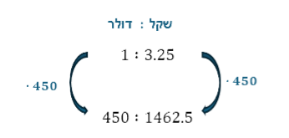
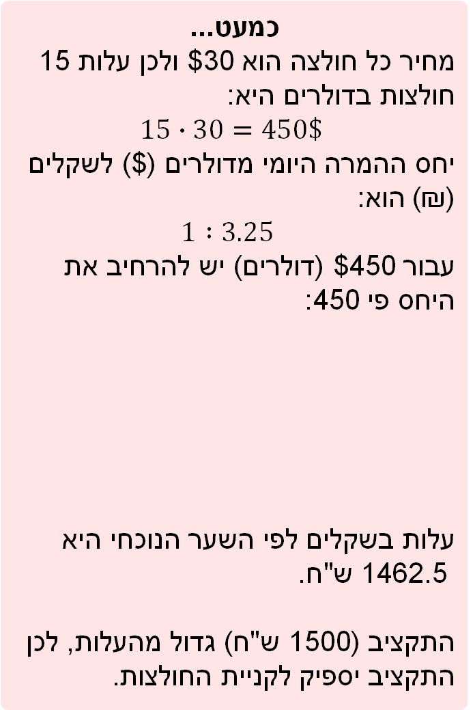

# שקף 76

**תבנית:** SingleChoiceQuestion

## הנחיות הפקה (מתוך הערות השקף)

- שם המסך בפיגמה: SingleChoiceQuestion
- רמז יוצג אחרי ניסיון 1
- אין צורך בסרגל התקדמות

## תוכן השקף

- צדקתי?
- ה. לרשות הקבוצה עומד תקציב קבוע מראש של 1,500 ₪  לצורך רכישת חולצות ייצוגיות ל-15 התלמידים (אין צורך לקנות חולצות למדריכים).
- מחיר כל חולצה בחנות המחנה הוא 30$.
- האם התקציב שעומד לרשות הקבוצה יספיק כדי לרכוש חולצות לכל התלמידים?
- אפשר רמז?
- חזרה
- רמת חשיבה
- טקסט
- טקסט
- נכון!
- מחיר כל חולצה הוא 30$ ולכן עלות 15 חולצות בדולרים היא:
- יחס ההמרה היומי מדולרים ($) לשקלים (₪) הוא:
- עבור 450$ (דולרים) יש להרחיב את היחס פי 450:
- עלות בשקלים לפי השער הנוכחי היא 1462.5  ש"ח.
- התקציב (1500 ש"ח) גדול מהעלות, לכן התקציב יספיק לקניית החולצות.
- כדי לדעת אם התקציב מספיק, כדאי לפרק את השאלה לשלושה שלבים:
- 1.	מה העלות הכוללת של כל החולצות בדולרים?
- 2.	איך הופכים את הסכום הזה לשקלים לפי שער ההמרה שנתון בלוח?
- 3.	האם הסכום שקיבלתם בשקלים קטן או גדול מ-1500 ₪?
- חזרה לשאלה
- כמעט...
- מחיר כל חולצה הוא 30$ ולכן עלות 15 חולצות בדולרים היא:
- יחס ההמרה היומי מדולרים ($) לשקלים (₪) הוא:
- עבור 450$ (דולרים) יש להרחיב את היחס פי 450:
- עלות בשקלים לפי השער הנוכחי היא 1462.5  ש"ח.
- התקציב (1500 ש"ח) גדול מהעלות, לכן התקציב יספיק לקניית החולצות.
- לא ניתן לדעת
- לא
- כן

## תמונות רפרנס

