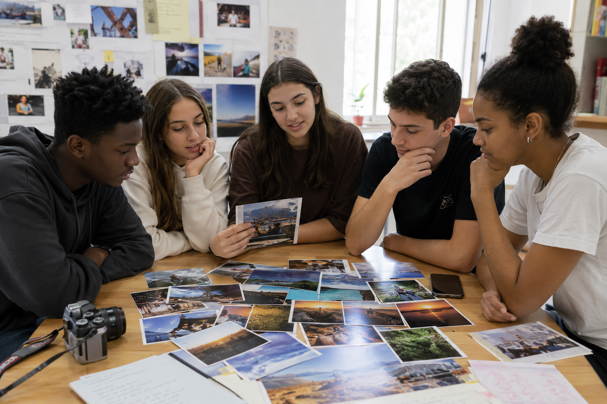

# שקף 79

**תבנית:** FullImageWithTextOverlay

## הנחיות הפקה (מתוך הערות השקף)

- שם המסך בפגימה: FullImageWithTextOverlay
- דמות ובועית דיבור עולות 2 שניות אחרי הטקסט ורק אז כפתור "המשך" הופך פעיל.

## תוכן השקף

- בשכבת ח מתקיימת השנה תערוכת צילום שבה יוצגו תמונות שהתלמידות והתלמידים צילמו בטלפון הנייד במהלך השנה.
- ועדת התערוכה אחראית להגדיל חלק מהתמונות הנבחרות ולהדפיס אותן כפוסטרים שייתלו על קירות האולם.
- לפני ההדפסה, צריך לתכנן במדויק:
- כמה מקום יש על הקיר, כמה פוסטרים אפשר לתלות, ובאיזה מחיר כדאי להדפיס.
- חזרה

## תמונות רפרנס

