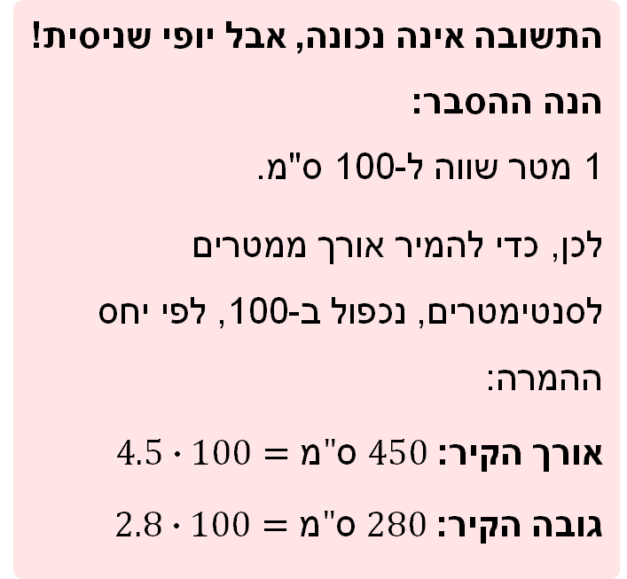
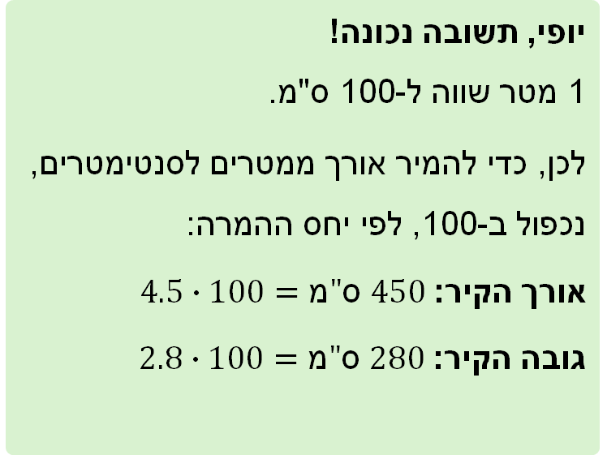

# שקף 80

**תבנית:** ValueInputQuestion

## הנחיות הפקה (מתוך הערות השקף)

- שם המסך בפיגמה:ValueInputQuestion
- רמז יוצג אחרי ניסיון 1
- אורייני: כן, רמת חשיבה גבוהה : לא

## תוכן השקף

- א. מידות קיר האולם שעליו יתלו הפוסטרים הן:
- אורך 4.5 מטרים
- גובה 2.8 מטרים.
- המירו את מידות הקיר לסנטימטרים (ס"מ):
- אורך הקיר        450          ס"מ
- גובה הקיר       280           ס"מ
- צדקתי?
- אפשר רמז?
- חזרה
- יופי, תשובה נכונה!
- 1 מטר שווה ל-100 ס"מ.
- לכן, כדי להמיר אורך ממטרים לסנטימטרים, נכפול ב-100, לפי יחס ההמרה:
- אורך הקיר:
- גובה הקיר:
- העזרו ביחס ההמרה 1 מטר = 100 ס"מ.
- חזרה לשאלה
- התשובה אינה נכונה, אבל יופי שניסית!
- הנה ההסבר:
- 1 מטר שווה ל-100 ס"מ.
- לכן, כדי להמיר אורך ממטרים לסנטימטרים, נכפול ב-100, לפי יחס ההמרה:
- אורך הקיר:
- גובה הקיר:
- זה הזמן להיעזר בכל מה שלמדנו על פרופורציות כדי לעזור לוועדה לתכנן את התערוכה!

## תמונות רפרנס

