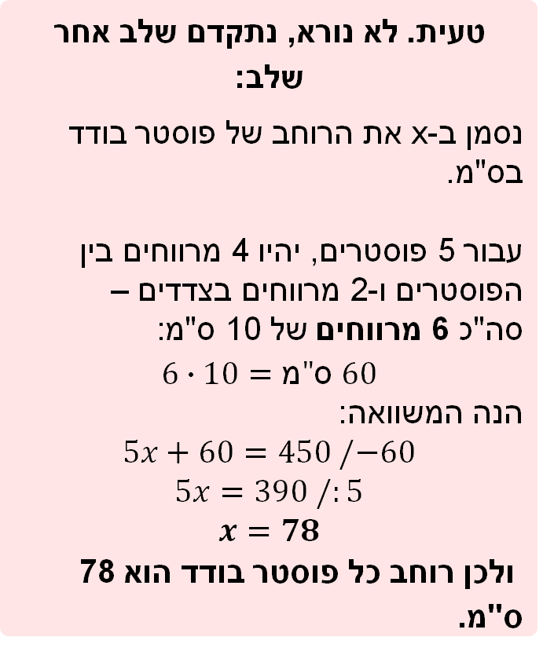
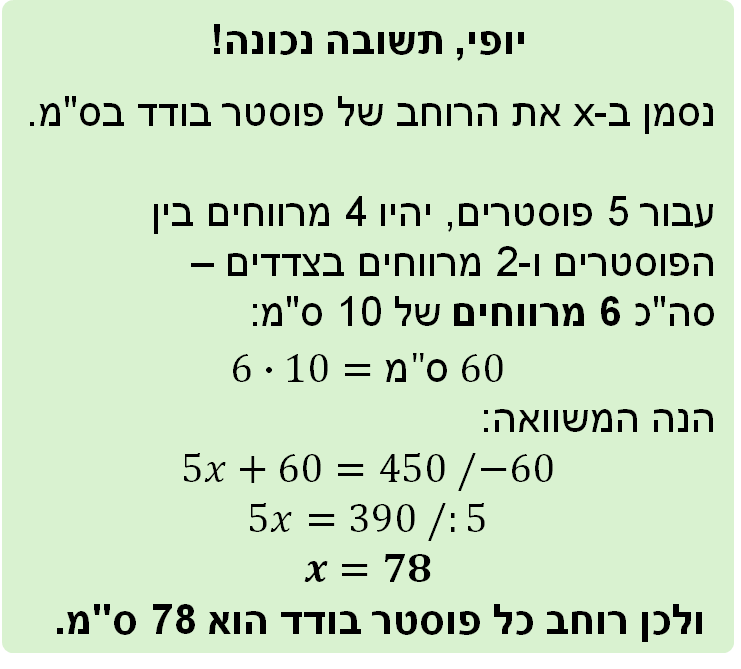
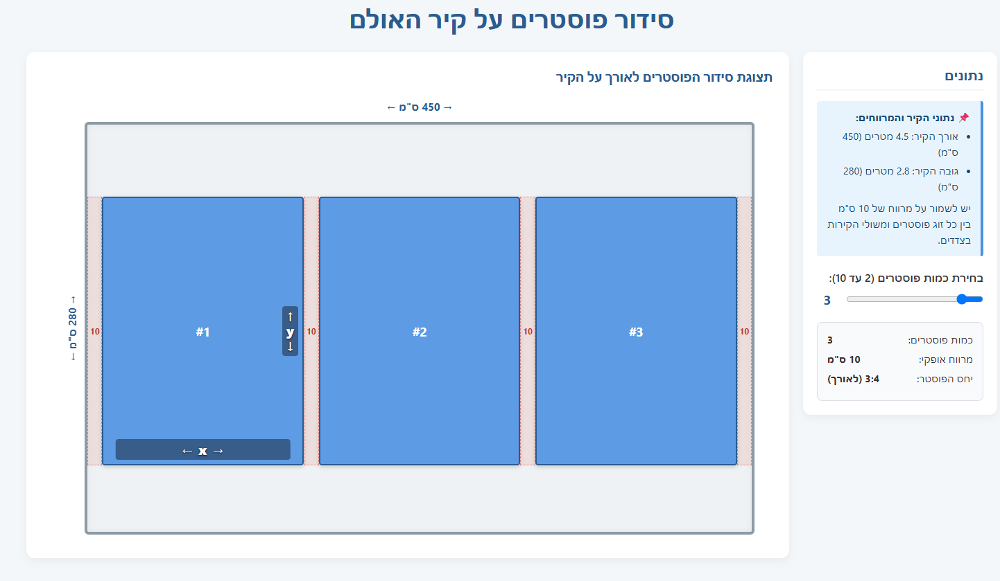

# שקף 81

**תבנית:** ValueInputQuestion

## הנחיות הפקה (מתוך הערות השקף)

- שם המסך בפיגמה:ValueInputQuestion
- רמז יוצג אחרי ניסיון 1
- אורייני: כן, רמת חשיבה גבוהה : לא
- קישור ליישומוןhttps://methodiccoil.sharepoint.com/:u:/g/IQB_EWQlufc1R4tESbDeZWMIAXmyboJnYoQQVr4fnLWO3AU?e=PB4AhR:

## תוכן השקף

- צדקתי?
- אפשר רמז?
- חזרה
- יופי, תשובה נכונה!
- נסמן ב-x את הרוחב של פוסטר בודד בס"מ.
- עבור 5 פוסטרים, יהיו 4 מרווחים בין הפוסטרים ו-2 מרווחים בצדדים –
- סה"כ 6 מרווחים של 10 ס"מ:
- הנה המשוואה:
- ולכן רוחב כל פוסטר בודד הוא 78 ס"מ.
- כמה מרווחים של 10 ס"מ נוצרו עבור 5 פוסטרים?
- חזרה לשאלה
- טעית. לא נורא, נתקדם שלב אחר שלב:
- נסמן ב-x את הרוחב של פוסטר בודד בס"מ.
- עבור 5 פוסטרים, יהיו 4 מרווחים בין הפוסטרים ו-2 מרווחים בצדדים –
- סה"כ 6 מרווחים של 10 ס"מ:
- הנה המשוואה:
- ולכן רוחב כל פוסטר בודד הוא 78 ס"מ.
- 78
- ב. את הפוסטרים על הקיר יש לתלות כך שיישמר מרווח של 10 ס"מ בין כל שני פוסטרים סמוכים, וגם מרווח של 10 ס"מ בין הפוסטרים שבקצוות לבין שולי הקיר בצדדים.
- היעזרו ביישומון וחשבו:
- מה צריך להיות רוחב כל פוסטר, אם נרצה לתלות 5 פוסטרים על הקיר?
- ס"מ

## תמונות רפרנס

