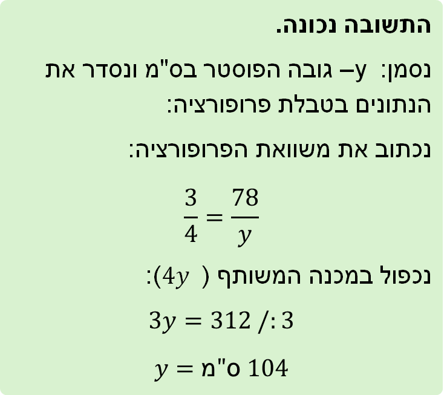
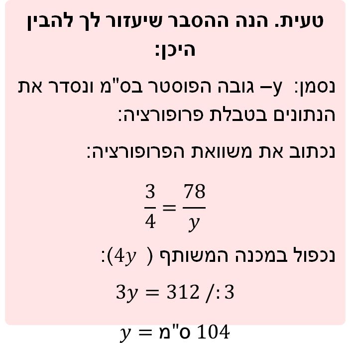

# שקף 82

**תבנית:** ValueInputQuestion

## הנחיות הפקה (מתוך הערות השקף)

- שם המסך בפיגמה:ValueInputQuestion
- רמז יוצג אחרי ניסיון 1
- אורייני: כן, רמת חשיבה גבוהה : לא

## תוכן השקף

- צדקתי?
- אפשר רמז?
- חזרה
- התשובה נכונה.
- נסמן: y – גובה הפוסטר בס"מ ונסדר את הנתונים בטבלת פרופורציה:
- נכתוב את משוואת הפרופורציה:
- נכפול במכנה המשותף ( ):
- העזרו בטבלת הפרופורציה:
- חזרה לשאלה
- טעית. הנה ההסבר שיעזור לך להבין היכן:
- נסמן: y – גובה הפוסטר בס"מ ונסדר את הנתונים בטבלת פרופורציה:
- נכתוב את משוואת הפרופורציה:
- נכפול במכנה המשותף ( ):
- 104
- ג. התלמידים התבקשו לצלם את התמונות בנייד ביחס בין רוחב לגובה התמונה של 3:4.
- ס"מ
- על מנת שהתמונות לא יתעוותו, הפוסטרים יודפסו תוך שמירה על אותו יחס בין הרוחב לגובה.
- מצאנו שרוחב פוסטר הוא 78 ס"מ.
- מה גובה הפוסטר שישמור על הפרופורציה המתאימה?
- רוחב
- גובה
- 3
- 4
- 78 ס"מ

## תמונות רפרנס

## הערות תיקוף (PPTX comments)

- **Guest User** (resolved): ניצה: לא צריך "במצב". כך שהיחס בין רוחב התמונה לגובה התמונה יהיה 3:4. קודם המלל ואחר כך הנתונים של היחס
