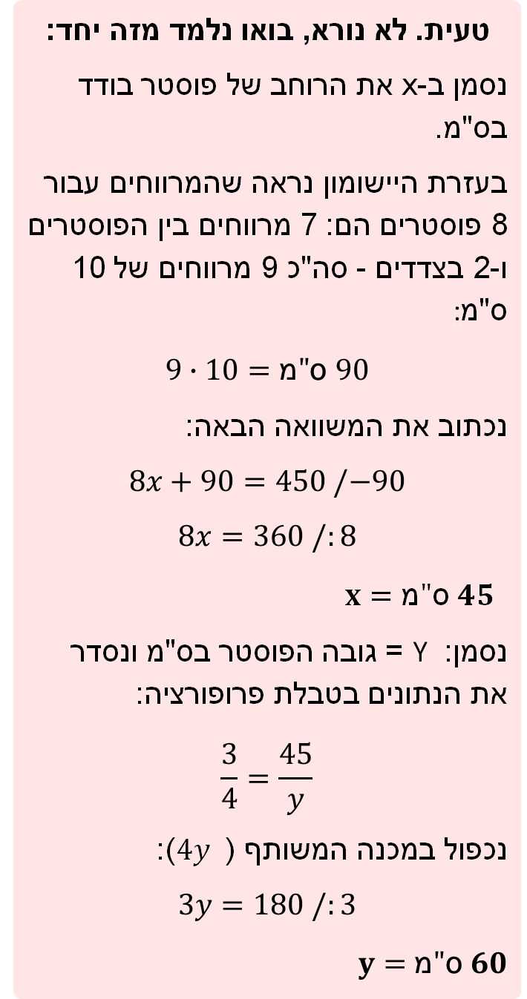
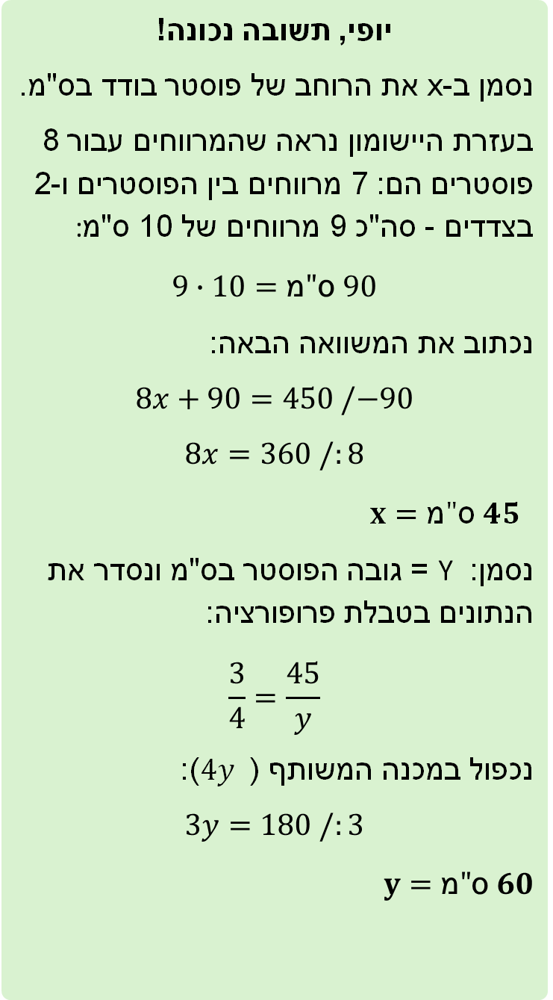
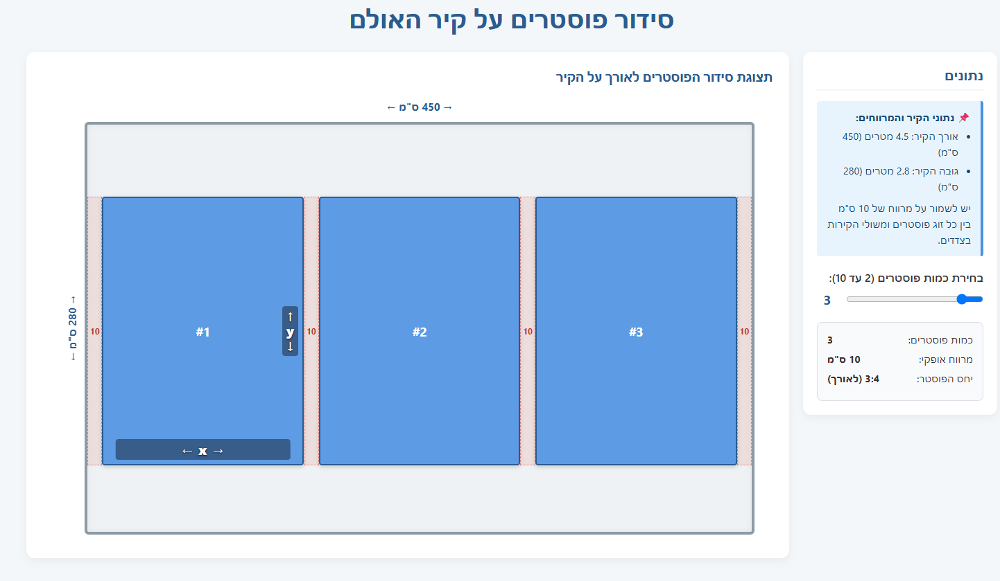

# שקף 83

**תבנית:** ValueInputQuestion

## הנחיות הפקה (מתוך הערות השקף)

- שם המסך בפיגמה:ValueInputQuestion
- רמז יוצג אחרי ניסיון 1
- אורייני: כן, רמת חשיבה גבוהה : לא
- משוב עם גלילה
- קישור ליישומוןhttps://methodiccoil.sharepoint.com/:u:/g/IQB_EWQlufc1R4tESbDeZWMIAXmyboJnYoQQVr4fnLWO3AU?e=PB4AhR:

## תוכן השקף

- צדקתי?
- אפשר רמז?
- חזרה
- יופי, תשובה נכונה!
- נסמן ב-x את הרוחב של פוסטר בודד בס"מ.
- בעזרת היישומון נראה שהמרווחים עבור 8 פוסטרים הם: 7 מרווחים בין הפוסטרים ו-2 בצדדים - סה"כ 9 מרווחים של 10 ס"מ:
- נכתוב את המשוואה הבאה:
- נסמן:  Y = גובה הפוסטר בס"מ ונסדר את הנתונים בטבלת פרופורציה:
- נכפול במכנה המשותף ( ):
- התחילו בחישוב רוחב כל פוסטר - העזרו ביישומון.
- חזרה לשאלה
- טעית. לא נורא, בואו נלמד מזה יחד:
- נסמן ב-x את הרוחב של פוסטר בודד בס"מ.
- בעזרת היישומון נראה שהמרווחים עבור 8 פוסטרים הם: 7 מרווחים בין הפוסטרים ו-2 בצדדים - סה"כ 9 מרווחים של 10 ס"מ:
- נכתוב את המשוואה הבאה:
- נסמן:  Y = גובה הפוסטר בס"מ ונסדר את הנתונים בטבלת פרופורציה:
- נכפול במכנה המשותף ( ):
- ד. שלוש תלמידות נוספות מצטרפות לתערוכה, וכעת יש לחשב מחדש את רוחב הפוסטרים.
- מה יהיו ממדי כל פוסטר, אם נרצה לתלות 8 פוסטרים?
- נזכיר כי היחס בין רוחב לגובה התמונות המצולמות בטלפון הנייד הוא 3:4.
- רוחב:      45          ס"מ
- גובה:      60           ס"מ
- רוחב
- גובה
- 3
- 4
- 45 ס"מ
- y ס"מ

## תמונות רפרנס

