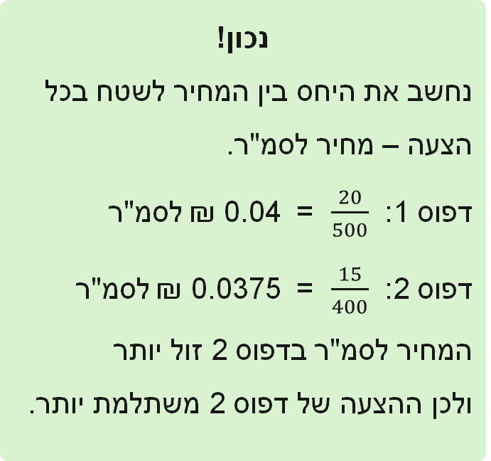
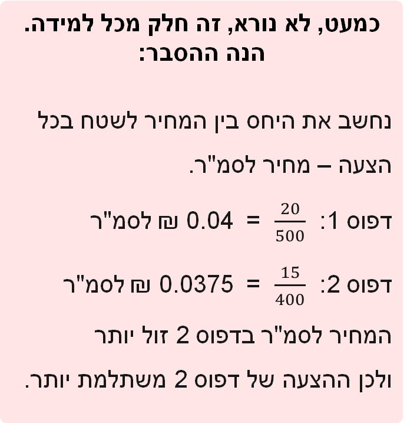

# שקף 84

**תבנית:** SingleChoiceQuestion

## הנחיות הפקה (מתוך הערות השקף)

- שם המסך בפיגמה: SingleChoiceQuestion
- רמז יוצג אחרי ניסיון 1
- אין צורך בסרגל התקדמות
- תמונה: בית דפוס_שאלת שיא ב_סעיף ה

## תוכן השקף

- צדקתי?
- ה. התלמידות והתלמידים פנו לשני בתי דפוס להצעות מחיר כדי להדפיס
- את הפוסטרים. התקבלו שתי הצעות מחיר: דפוס 1: 20 ₪ לכל 500 סמ"רדפוס 2: 15 ₪ לכל 400 סמ"ראיזו הצעה משתלמת יותר?
- אפשר רמז?
- חזרה
- רמת חשיבה
- טקסט
- טקסט
- נכון!
- נחשב את היחס בין המחיר לשטח בכל הצעה – מחיר לסמ"ר.
- דפוס 1:    =  0.04 ₪ לסמ"ר
- דפוס 2:    =  0.0375 ₪ לסמ"ר
- המחיר לסמ"ר בדפוס 2 זול יותר
- ולכן ההצעה של דפוס 2 משתלמת יותר.
- בכדי להשוות בין ההצעות, צריך לדעת מה יהיה המחיר עבור אותו שטח.
- חזרה לשאלה
- כמעט, לא נורא, זה חלק מכל למידה.
- הנה ההסבר:
- נחשב את היחס בין המחיר לשטח בכל הצעה – מחיר לסמ"ר.
- דפוס 1:    =  0.04 ₪ לסמ"ר
- דפוס 2:    =  0.0375 ₪ לסמ"ר
- המחיר לסמ"ר בדפוס 2 זול יותר
- ולכן ההצעה של דפוס 2 משתלמת יותר.
- שתי ההצעות משתלמות באותה מידה
- דפוס 2
- דפוס 1
- לא ניתן לקבוע

## תמונות רפרנס

## הערות תיקוף (PPTX comments)

- **Guest User** (resolved): ניצה: התלמידים פנו לשני בתי דפוס לקבלת הצעות מחיר כדי להדפיס את הפוסטרים. התלמידים קבלו שתי הצעות מחיר:
- **Guest User** (resolved): ניצה: מבחינת הנושא זה לקוח לכיוון אחר. אין קשר לפרופורציה בכלל.
-   ↳ **Efrat Fridman**: הם צריכים לחשב את היחס בין המחיר לשטח הפוסטרים
