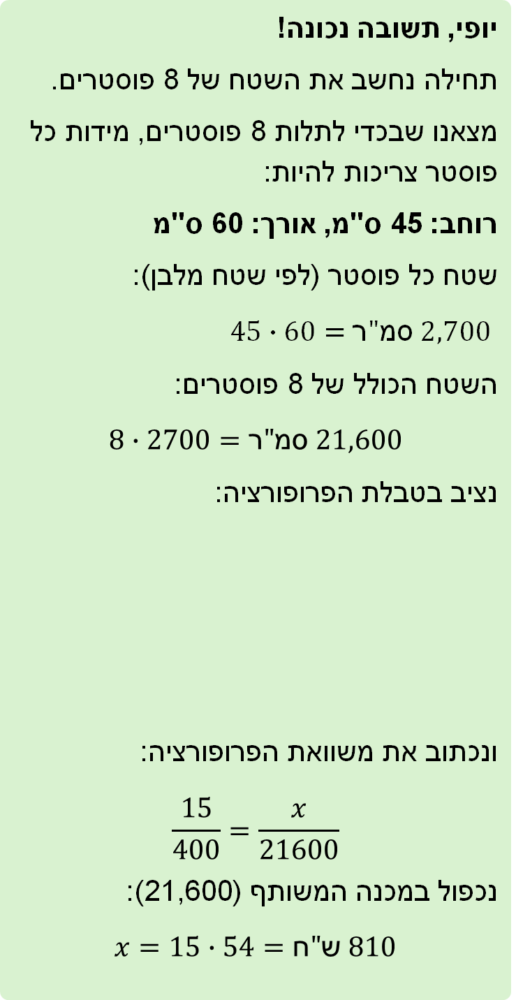
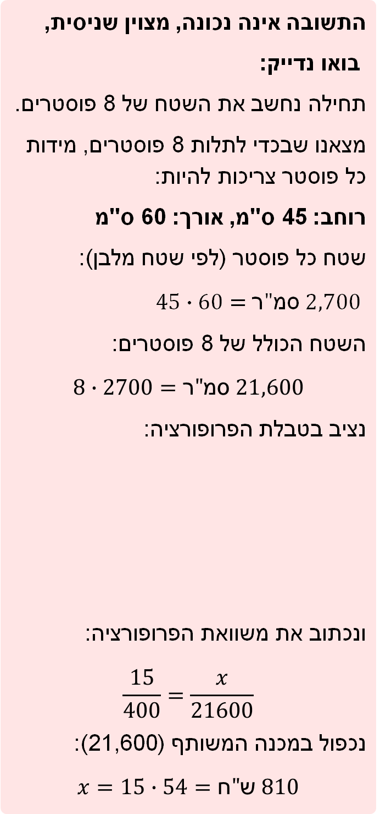

# שקף 85

**תבנית:** ValueInputQuestion

## הנחיות הפקה (מתוך הערות השקף)

- שם המסך בפיגמה:ValueInputQuestion
- רמז יוצג אחרי ניסיון 1
- הקלדת ערך מדויק, אורייני: כן, רמת חשיבה גבוהה : כן

## תוכן השקף

- ו. הועד בחר בהצעה של דפוס 2, בה המחיר הוא 15 ₪ לכל 400 סמ"ר.
- השלימו: מה יהיה מחיר ההדפסה של 8 פוסטרים?
- 810       ש"ח
- צדקתי?
- אפשר רמז?
- חזרה
- יופי, תשובה נכונה!
- תחילה נחשב את השטח של 8 פוסטרים.
- מצאנו שבכדי לתלות 8 פוסטרים, מידות כל פוסטר צריכות להיות:
- רוחב: 45 ס"מ, אורך: 60 ס"מ
- שטח כל פוסטר (לפי שטח מלבן):
- השטח הכולל של 8 פוסטרים:
- נציב בטבלת הפרופורציה:
- ונכתוב את משוואת הפרופורציה:
- נכפול במכנה המשותף (21,600):
- מה השטח הכולל של 8 פוסטרים?
- חזרה לשאלה
- התשובה אינה נכונה, מצוין שניסית,
- בואו נדייק:
- תחילה נחשב את השטח של 8 פוסטרים.
- מצאנו שבכדי לתלות 8 פוסטרים, מידות כל פוסטר צריכות להיות:
- רוחב: 45 ס"מ, אורך: 60 ס"מ
- שטח כל פוסטר (לפי שטח מלבן):
- השטח הכולל של 8 פוסטרים:
- נציב בטבלת הפרופורציה:
- ונכתוב את משוואת הפרופורציה:
- נכפול במכנה המשותף (21,600):
- מחיר
- שטח (סמ"ר)
- 15
- 400
- x
- 21,600
- מחיר
- שטח (סמ"ר)
- 15
- 400
- x
- 21,600

## תמונות רפרנס

## הערות תיקוף (PPTX comments)

- **Guest User** (resolved): להוסיף אולי איזה שקף סיפורי עם סיום לסיפור

התערוכה הצליחה או משהו בסגנון
